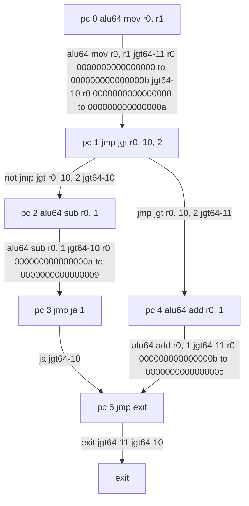
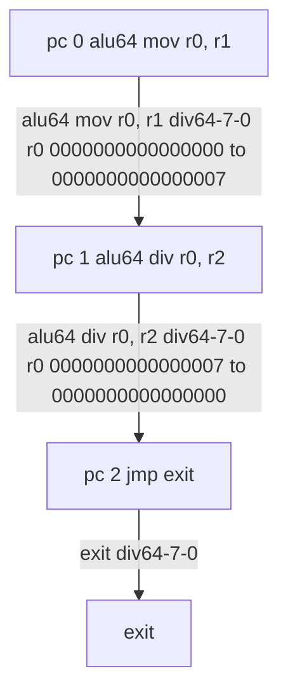

# Exhibit

Run `alive2/exhibit/regen.sh` from the repository root.

## Why the link line stays

ebpf-concrete does not call smt:: or Z3. It still links libir, libsmt, libtools, libutil, and libz3 because alive2_link is shared with ebpf_test. ebpf_lift.cpp builds IR instructions whose methods live in instr.cpp. instr.cpp references IR::State. state.cpp calls smt::Solver. smt::expr is a Z3 AST. Dropping libsmt or Z3 leaves those symbols undefined. A second helper that still links those libraries does not remove them.

## Missing from the Alive2 step

These fields are not in the result of `execute_ebpf`. The list is not filled in.

- pc-indexed symbolic pre-state and post-state for r0-r10
- the compare as its own smt::expr
- the path condition at that pc (getPath dies with IR::State)
- per-instruction symbolic UB
- memory before and after as expressions
- phi operands as data

## JGT64

Bytes from fixture `jgt64-11`, the same bytes as `jgt64-10`.

`bf10000000000000250002000a0000001700000001000000050001000000000007000000010000009500000000000000`

### JGT64 execute_ebpf

Decoded instructions.

```
0: alu64 mov r0, r1
1: jmp jgt r0, 10, 2
2: alu64 sub r0, 1
3: jmp ja 1
4: alu64 add r0, 1
5: jmp exit
```

Alive2 block cfg from `execute_ebpf`.

```
b0 -> b2 or b1
b1 -> b3
b2 -> b3
b3 exit
```

Alive2 IR from `execute_ebpf`.

```
define i64 @ebpf(i64 r1) memory(none) {
entry:
  br label %b0

b0:
  %0 = icmp ugt i64 r1, 10
  br i1 %0, label %b2, label %b1

b2:
  %2 = add i64 r1, 1
  br label %b3

b1:
  %1 = sub i64 r1, 1
  br label %b3

b3:
  %b3_r0 = phi i64 [ %1, %b1 ], [ %2, %b2 ]
  ret i64 %b3_r0
}
```

`execute_ebpf` memory field.

```
none
```

`value` is the path-merged return, not the concrete r0 of either JGT input.

`defined` is function_domain.

<!-- smt-start -->
```
(and (= #b0 isundef_r1) np_r1)
```
<!-- smt-end -->

`non_poison` is the Alive2 return non_poison expression.

<!-- smt-start -->
```
true
```
<!-- smt-end -->

`returned` is the Alive2 return_domain expression.

<!-- smt-start -->
```
(and (= #b0 isundef_r1) np_r1)
```
<!-- smt-end -->

`value` is the path-merged return.

<!-- smt-start -->
```
(ite (bvule #x000000000000000b r1)
     (bvadd #x0000000000000001 r1)
     (bvadd r1 #xffffffffffffffff))
```
<!-- smt-end -->

### Graph

Edges come from the gate. A trace may label an edge. It does not add or drop one.



### Rocq citations

Citation for pc0. `Definition find_instr` in ebpfDecoder.v. `Definition exec_instr`, `Definition exec_alu`, `Definition eval_alu64`, `Definition nextinstr` in ebpfBinSem.v. This note names the definitions. Rocq did not print this term.

Citation for pc1. `Definition find_instr` in ebpfDecoder.v. `Definition exec_instr`, `Definition exec_jmpcmp`, `Definition eval_cmp_static`, `Definition eval_cmp64`, `Definition nextinstr` in ebpfBinSem.v. This note names the definitions. Rocq did not print this term.

`eval_cmp_static` is not the result for immediate 10. Its W64 GT Unsigned arm matches only the immediate -1. `exec_jmpcmp` tries `eval_cmp_static`, then `eval_cmp64` for W64.

Citation for pc2. `Definition find_instr` in ebpfDecoder.v. `Definition exec_instr`, `Definition exec_alu`, `Definition eval_alu64`, `Definition nextinstr` in ebpfBinSem.v. This note names the definitions. Rocq did not print this term.

Citation for pc3. `Definition find_instr` in ebpfDecoder.v. `Definition exec_instr`, `Definition exec_jmp64`, `Definition nextinstr` in ebpfBinSem.v. This note names the definitions. Rocq did not print this term.

Citation for pc4. `Definition find_instr` in ebpfDecoder.v. `Definition exec_instr`, `Definition exec_alu`, `Definition eval_alu64`, `Definition nextinstr` in ebpfBinSem.v. This note names the definitions. Rocq did not print this term.

Citation for pc5. `Definition find_instr` in ebpfDecoder.v. `Definition exec_instr`, `Definition exec_ret` in ebpfBinSem.v. This note names the definitions. Rocq did not print this term.

### Concrete steps

The concrete step is the state at the end of the eBPF instruction, not the state of each IR block.

### pc0 jgt64-11

R_r(pc0, S, S') for jgt64-11.

S is r0=UNDEF r1=000000000000000b r2=UNDEF r3=UNDEF r4=UNDEF r5=UNDEF r6=UNDEF r7=UNDEF r8=UNDEF r9=UNDEF.

S' is r0=000000000000000b r1=000000000000000b r2=UNDEF r3=UNDEF r4=UNDEF r5=UNDEF r6=UNDEF r7=UNDEF r8=UNDEF r9=UNDEF.

R_a(pc0, S, S') for jgt64-11.

S is r0=0000000000000000 r1=000000000000000b r2=0000000000000000 r3=0000000000000000 r4=0000000000000000 r5=0000000000000000 r6=0000000000000000 r7=0000000000000000 r8=0000000000000000 r9=0000000000000000.

S' is r0=000000000000000b r1=000000000000000b r2=0000000000000000 r3=0000000000000000 r4=0000000000000000 r5=0000000000000000 r6=0000000000000000 r7=0000000000000000 r8=0000000000000000 r9=0000000000000000.

r2, r3, r4, r5, r6, r7, r8, and r9 are UNDEF on the Rocq side. The comparator skips those cells because those registers were not read.

Status is NEXT.

PC update is pc0 to pc1.

Memory effect is empty. That is the m returned by Next in `exec_alu`.

Return value is none.

Source bytes are bf10000000000000.

### pc0 jgt64-10

R_r(pc0, S, S') for jgt64-10.

S is r0=UNDEF r1=000000000000000a r2=UNDEF r3=UNDEF r4=UNDEF r5=UNDEF r6=UNDEF r7=UNDEF r8=UNDEF r9=UNDEF.

S' is r0=000000000000000a r1=000000000000000a r2=UNDEF r3=UNDEF r4=UNDEF r5=UNDEF r6=UNDEF r7=UNDEF r8=UNDEF r9=UNDEF.

R_a(pc0, S, S') for jgt64-10.

S is r0=0000000000000000 r1=000000000000000a r2=0000000000000000 r3=0000000000000000 r4=0000000000000000 r5=0000000000000000 r6=0000000000000000 r7=0000000000000000 r8=0000000000000000 r9=0000000000000000.

S' is r0=000000000000000a r1=000000000000000a r2=0000000000000000 r3=0000000000000000 r4=0000000000000000 r5=0000000000000000 r6=0000000000000000 r7=0000000000000000 r8=0000000000000000 r9=0000000000000000.

r2, r3, r4, r5, r6, r7, r8, and r9 are UNDEF on the Rocq side. The comparator skips those cells because those registers were not read.

Status is NEXT.

PC update is pc0 to pc1.

Memory effect is empty. That is the m returned by Next in `exec_alu`.

Return value is none.

Source bytes are bf10000000000000.

### pc1 jgt64-11

R_r(pc1, S, S') for jgt64-11.

S is r0=000000000000000b r1=000000000000000b r2=UNDEF r3=UNDEF r4=UNDEF r5=UNDEF r6=UNDEF r7=UNDEF r8=UNDEF r9=UNDEF.

S' is r0=000000000000000b r1=000000000000000b r2=UNDEF r3=UNDEF r4=UNDEF r5=UNDEF r6=UNDEF r7=UNDEF r8=UNDEF r9=UNDEF.

R_a(pc1, S, S') for jgt64-11.

S is r0=000000000000000b r1=000000000000000b r2=0000000000000000 r3=0000000000000000 r4=0000000000000000 r5=0000000000000000 r6=0000000000000000 r7=0000000000000000 r8=0000000000000000 r9=0000000000000000.

S' is r0=000000000000000b r1=000000000000000b r2=0000000000000000 r3=0000000000000000 r4=0000000000000000 r5=0000000000000000 r6=0000000000000000 r7=0000000000000000 r8=0000000000000000 r9=0000000000000000.

r2, r3, r4, r5, r6, r7, r8, and r9 are UNDEF on the Rocq side. The comparator skips those cells because those registers were not read.

Status is NEXT.

PC update is pc1 to pc4.

Memory effect is empty. That is the m returned by Next in `exec_jmpcmp`.

Return value is none.

Source bytes are 250002000a000000.

### pc1 jgt64-10

R_r(pc1, S, S') for jgt64-10.

S is r0=000000000000000a r1=000000000000000a r2=UNDEF r3=UNDEF r4=UNDEF r5=UNDEF r6=UNDEF r7=UNDEF r8=UNDEF r9=UNDEF.

S' is r0=000000000000000a r1=000000000000000a r2=UNDEF r3=UNDEF r4=UNDEF r5=UNDEF r6=UNDEF r7=UNDEF r8=UNDEF r9=UNDEF.

R_a(pc1, S, S') for jgt64-10.

S is r0=000000000000000a r1=000000000000000a r2=0000000000000000 r3=0000000000000000 r4=0000000000000000 r5=0000000000000000 r6=0000000000000000 r7=0000000000000000 r8=0000000000000000 r9=0000000000000000.

S' is r0=000000000000000a r1=000000000000000a r2=0000000000000000 r3=0000000000000000 r4=0000000000000000 r5=0000000000000000 r6=0000000000000000 r7=0000000000000000 r8=0000000000000000 r9=0000000000000000.

r2, r3, r4, r5, r6, r7, r8, and r9 are UNDEF on the Rocq side. The comparator skips those cells because those registers were not read.

Status is NEXT.

PC update is pc1 to pc2.

Memory effect is empty. That is the m returned by Next in `exec_jmpcmp`.

Return value is none.

Source bytes are 250002000a000000.

### pc2 jgt64-10

R_r(pc2, S, S') for jgt64-10.

S is r0=000000000000000a r1=000000000000000a r2=UNDEF r3=UNDEF r4=UNDEF r5=UNDEF r6=UNDEF r7=UNDEF r8=UNDEF r9=UNDEF.

S' is r0=0000000000000009 r1=000000000000000a r2=UNDEF r3=UNDEF r4=UNDEF r5=UNDEF r6=UNDEF r7=UNDEF r8=UNDEF r9=UNDEF.

R_a(pc2, S, S') for jgt64-10.

S is r0=000000000000000a r1=000000000000000a r2=0000000000000000 r3=0000000000000000 r4=0000000000000000 r5=0000000000000000 r6=0000000000000000 r7=0000000000000000 r8=0000000000000000 r9=0000000000000000.

S' is r0=0000000000000009 r1=000000000000000a r2=0000000000000000 r3=0000000000000000 r4=0000000000000000 r5=0000000000000000 r6=0000000000000000 r7=0000000000000000 r8=0000000000000000 r9=0000000000000000.

r2, r3, r4, r5, r6, r7, r8, and r9 are UNDEF on the Rocq side. The comparator skips those cells because those registers were not read.

Status is NEXT.

PC update is pc2 to pc3.

Memory effect is empty. That is the m returned by Next in `exec_alu`.

Return value is none.

Source bytes are 1700000001000000.

### pc3 jgt64-10

R_r(pc3, S, S') for jgt64-10.

S is r0=0000000000000009 r1=000000000000000a r2=UNDEF r3=UNDEF r4=UNDEF r5=UNDEF r6=UNDEF r7=UNDEF r8=UNDEF r9=UNDEF.

S' is r0=0000000000000009 r1=000000000000000a r2=UNDEF r3=UNDEF r4=UNDEF r5=UNDEF r6=UNDEF r7=UNDEF r8=UNDEF r9=UNDEF.

R_a(pc3, S, S') for jgt64-10.

S is r0=0000000000000009 r1=000000000000000a r2=0000000000000000 r3=0000000000000000 r4=0000000000000000 r5=0000000000000000 r6=0000000000000000 r7=0000000000000000 r8=0000000000000000 r9=0000000000000000.

S' is r0=0000000000000009 r1=000000000000000a r2=0000000000000000 r3=0000000000000000 r4=0000000000000000 r5=0000000000000000 r6=0000000000000000 r7=0000000000000000 r8=0000000000000000 r9=0000000000000000.

r2, r3, r4, r5, r6, r7, r8, and r9 are UNDEF on the Rocq side. The comparator skips those cells because those registers were not read.

Status is NEXT.

PC update is pc3 to pc5.

Memory effect is empty. That is the m returned by Next in `exec_jmp64`.

Return value is none.

Source bytes are 0500010000000000.

### pc4 jgt64-11

R_r(pc4, S, S') for jgt64-11.

S is r0=000000000000000b r1=000000000000000b r2=UNDEF r3=UNDEF r4=UNDEF r5=UNDEF r6=UNDEF r7=UNDEF r8=UNDEF r9=UNDEF.

S' is r0=000000000000000c r1=000000000000000b r2=UNDEF r3=UNDEF r4=UNDEF r5=UNDEF r6=UNDEF r7=UNDEF r8=UNDEF r9=UNDEF.

R_a(pc4, S, S') for jgt64-11.

S is r0=000000000000000b r1=000000000000000b r2=0000000000000000 r3=0000000000000000 r4=0000000000000000 r5=0000000000000000 r6=0000000000000000 r7=0000000000000000 r8=0000000000000000 r9=0000000000000000.

S' is r0=000000000000000c r1=000000000000000b r2=0000000000000000 r3=0000000000000000 r4=0000000000000000 r5=0000000000000000 r6=0000000000000000 r7=0000000000000000 r8=0000000000000000 r9=0000000000000000.

r2, r3, r4, r5, r6, r7, r8, and r9 are UNDEF on the Rocq side. The comparator skips those cells because those registers were not read.

Status is NEXT.

PC update is pc4 to pc5.

Memory effect is empty. That is the m returned by Next in `exec_alu`.

Return value is none.

Source bytes are 0700000001000000.

### pc5 jgt64-11

R_r(pc5, S, S') for jgt64-11.

S is r0=000000000000000c r1=000000000000000b r2=UNDEF r3=UNDEF r4=UNDEF r5=UNDEF r6=UNDEF r7=UNDEF r8=UNDEF r9=UNDEF.

S' is r0=000000000000000c r1=000000000000000b r2=UNDEF r3=UNDEF r4=UNDEF r5=UNDEF r6=UNDEF r7=UNDEF r8=UNDEF r9=UNDEF.

R_a(pc5, S, S') for jgt64-11.

S is r0=000000000000000c r1=000000000000000b r2=0000000000000000 r3=0000000000000000 r4=0000000000000000 r5=0000000000000000 r6=0000000000000000 r7=0000000000000000 r8=0000000000000000 r9=0000000000000000.

S' is r0=000000000000000c r1=000000000000000b r2=0000000000000000 r3=0000000000000000 r4=0000000000000000 r5=0000000000000000 r6=0000000000000000 r7=0000000000000000 r8=0000000000000000 r9=0000000000000000.

r2, r3, r4, r5, r6, r7, r8, and r9 are UNDEF on the Rocq side. The comparator skips those cells because those registers were not read.

Status is EXIT.

PC update is pc5 to exit.

Memory effect is empty. `exec_ret` on an empty call stack returns Next with PC set to Vnullptr and the same m. The return value is r0.

Return value is 000000000000000c.

Source bytes are 9500000000000000.

### pc5 jgt64-10

R_r(pc5, S, S') for jgt64-10.

S is r0=0000000000000009 r1=000000000000000a r2=UNDEF r3=UNDEF r4=UNDEF r5=UNDEF r6=UNDEF r7=UNDEF r8=UNDEF r9=UNDEF.

S' is r0=0000000000000009 r1=000000000000000a r2=UNDEF r3=UNDEF r4=UNDEF r5=UNDEF r6=UNDEF r7=UNDEF r8=UNDEF r9=UNDEF.

R_a(pc5, S, S') for jgt64-10.

S is r0=0000000000000009 r1=000000000000000a r2=0000000000000000 r3=0000000000000000 r4=0000000000000000 r5=0000000000000000 r6=0000000000000000 r7=0000000000000000 r8=0000000000000000 r9=0000000000000000.

S' is r0=0000000000000009 r1=000000000000000a r2=0000000000000000 r3=0000000000000000 r4=0000000000000000 r5=0000000000000000 r6=0000000000000000 r7=0000000000000000 r8=0000000000000000 r9=0000000000000000.

r2, r3, r4, r5, r6, r7, r8, and r9 are UNDEF on the Rocq side. The comparator skips those cells because those registers were not read.

Status is EXIT.

PC update is pc5 to exit.

Memory effect is empty. `exec_ret` on an empty call stack returns Next with PC set to Vnullptr and the same m. The return value is r0.

Return value is 0000000000000009.

Source bytes are 9500000000000000.

## DIV64

Bytes from fixture `div64-7-0`, the same bytes as `div64-7-0-div-zero-as-ub`.

`bf100000000000003f200000000000009500000000000000`

### DIV64 guarded execute_ebpf

Decoded instructions.

```
0: alu64 mov r0, r1
1: alu64 div r0, r2
2: jmp exit
```

Alive2 block cfg from `execute_ebpf`.

```
b0 exit
```

Alive2 IR from `execute_ebpf`.

```
define i64 @ebpf(i64 r1, i64 r2) memory(none) {
entry:
  br label %b0

b0:
  %0 = icmp eq i64 r2, 0
  br i1 %0, label %1, label %2

1:
  br label %3

2:
  %4 = udiv i64 r1, r2
  br label %3

3:
  %5 = phi i64 [ 0, %1 ], [ %4, %2 ]
  ret i64 %5
}
```

`execute_ebpf` memory field.

```
none
```

`value` is the path-merged return, not the concrete r0 of this input.

`defined` is function_domain.

<!-- smt-start -->
```
(and (= isundef_r2 #b0) (= #b0 isundef_r1) np_r1 np_r2)
```
<!-- smt-end -->

`non_poison` is the Alive2 return non_poison expression.

<!-- smt-start -->
```
true
```
<!-- smt-end -->

`returned` is the Alive2 return_domain expression.

<!-- smt-start -->
```
(and (= isundef_r2 #b0) (= #b0 isundef_r1) np_r1 np_r2)
```
<!-- smt-end -->

`value` is the path-merged return.

<!-- smt-start -->
```
(ite (= #x0000000000000000 r2) #x0000000000000000 (bvudiv r1 r2))
```
<!-- smt-end -->

The guarded print has the zero icmp, the udiv block, and the merge phi. One eBPF div is several IR blocks. The concrete step is still the end of that eBPF instruction.

### DIV64 div-zero-as-ub execute_ebpf

Decoded instructions.

```
0: alu64 mov r0, r1
1: alu64 div r0, r2
2: jmp exit
```

Alive2 block cfg from `execute_ebpf`.

```
b0 exit
```

Alive2 IR from `execute_ebpf`.

```
define i64 @ebpf(i64 r1, i64 r2) memory(none) {
entry:
  br label %b0

b0:
  %0 = udiv i64 r1, r2
  ret i64 %0
}
```

`execute_ebpf` memory field.

```
none
```

`value` is the path-merged return, not the concrete r0 of this input.

`defined` is function_domain.

<!-- smt-start -->
```
(and (= isundef_r2 #b0)
     (= #b0 isundef_r1)
     np_r1
     np_r2
     (not (= #x0000000000000000 r2)))
```
<!-- smt-end -->

`non_poison` is the Alive2 return non_poison expression.

<!-- smt-start -->
```
true
```
<!-- smt-end -->

`returned` is the Alive2 return_domain expression.

<!-- smt-start -->
```
(and (= isundef_r2 #b0)
     (= #b0 isundef_r1)
     np_r1
     np_r2
     (not (= #x0000000000000000 r2)))
```
<!-- smt-end -->

`value` is the path-merged return.

<!-- smt-start -->
```
(bvudiv r1 r2)
```
<!-- smt-end -->

The mutation print has a raw udiv.

### Graph

Edges come from the gate. A trace may label an edge. It does not add or drop one.



div64-7-0-div-zero-as-ub stops at pc1. The static fall-through stays.

### Rocq citations

Citation for pc0. `Definition find_instr` in ebpfDecoder.v. `Definition exec_instr`, `Definition exec_alu`, `Definition eval_alu64`, `Definition nextinstr` in ebpfBinSem.v. This note names the definitions. Rocq did not print this term.

Citation for pc1. `Definition find_instr` in ebpfDecoder.v. `Definition exec_instr`, `Definition exec_alu`, `Definition eval_alu64`, `Definition eval_div_u64`, `Definition nextinstr` in ebpfBinSem.v. This note names the definitions. Rocq did not print this term.

Citation for pc2. `Definition find_instr` in ebpfDecoder.v. `Definition exec_instr`, `Definition exec_ret` in ebpfBinSem.v. This note names the definitions. Rocq did not print this term.

### Concrete steps

The concrete step is the state at the end of the eBPF instruction, not the state of each IR block.

### pc0 div64-7-0

R_r(pc0, S, S') for div64-7-0.

S is r0=UNDEF r1=0000000000000007 r2=0000000000000000 r3=UNDEF r4=UNDEF r5=UNDEF r6=UNDEF r7=UNDEF r8=UNDEF r9=UNDEF.

S' is r0=0000000000000007 r1=0000000000000007 r2=0000000000000000 r3=UNDEF r4=UNDEF r5=UNDEF r6=UNDEF r7=UNDEF r8=UNDEF r9=UNDEF.

R_a(pc0, S, S') for div64-7-0.

S is r0=0000000000000000 r1=0000000000000007 r2=0000000000000000 r3=0000000000000000 r4=0000000000000000 r5=0000000000000000 r6=0000000000000000 r7=0000000000000000 r8=0000000000000000 r9=0000000000000000.

S' is r0=0000000000000007 r1=0000000000000007 r2=0000000000000000 r3=0000000000000000 r4=0000000000000000 r5=0000000000000000 r6=0000000000000000 r7=0000000000000000 r8=0000000000000000 r9=0000000000000000.

r3, r4, r5, r6, r7, r8, and r9 are UNDEF on the Rocq side. The comparator skips those cells because those registers were not read.

Status is NEXT.

PC update is pc0 to pc1.

Memory effect is empty. That is the m returned by Next in `exec_alu`.

Return value is none.

Source bytes are bf10000000000000.

### pc0 div64-7-0-div-zero-as-ub

R_r(pc0, S, S') for div64-7-0-div-zero-as-ub.

S is r0=UNDEF r1=0000000000000007 r2=0000000000000000 r3=UNDEF r4=UNDEF r5=UNDEF r6=UNDEF r7=UNDEF r8=UNDEF r9=UNDEF.

S' is r0=0000000000000007 r1=0000000000000007 r2=0000000000000000 r3=UNDEF r4=UNDEF r5=UNDEF r6=UNDEF r7=UNDEF r8=UNDEF r9=UNDEF.

R_a(pc0, S, S') for div64-7-0-div-zero-as-ub.

S is r0=0000000000000000 r1=0000000000000007 r2=0000000000000000 r3=0000000000000000 r4=0000000000000000 r5=0000000000000000 r6=0000000000000000 r7=0000000000000000 r8=0000000000000000 r9=0000000000000000.

S' is r0=0000000000000007 r1=0000000000000007 r2=0000000000000000 r3=0000000000000000 r4=0000000000000000 r5=0000000000000000 r6=0000000000000000 r7=0000000000000000 r8=0000000000000000 r9=0000000000000000.

r3, r4, r5, r6, r7, r8, and r9 are UNDEF on the Rocq side. The comparator skips those cells because those registers were not read.

Status is NEXT.

PC update is pc0 to pc1.

Memory effect is empty. That is the m returned by Next in `exec_alu`.

Return value is none.

Source bytes are bf10000000000000.

### pc1 div64-7-0

R_r(pc1, S, S') for div64-7-0.

S is r0=0000000000000007 r1=0000000000000007 r2=0000000000000000 r3=UNDEF r4=UNDEF r5=UNDEF r6=UNDEF r7=UNDEF r8=UNDEF r9=UNDEF.

S' is r0=0000000000000000 r1=0000000000000007 r2=0000000000000000 r3=UNDEF r4=UNDEF r5=UNDEF r6=UNDEF r7=UNDEF r8=UNDEF r9=UNDEF.

R_a(pc1, S, S') for div64-7-0.

S is r0=0000000000000007 r1=0000000000000007 r2=0000000000000000 r3=0000000000000000 r4=0000000000000000 r5=0000000000000000 r6=0000000000000000 r7=0000000000000000 r8=0000000000000000 r9=0000000000000000.

S' is r0=0000000000000000 r1=0000000000000007 r2=0000000000000000 r3=0000000000000000 r4=0000000000000000 r5=0000000000000000 r6=0000000000000000 r7=0000000000000000 r8=0000000000000000 r9=0000000000000000.

r3, r4, r5, r6, r7, r8, and r9 are UNDEF on the Rocq side. The comparator skips those cells because those registers were not read.

Status is NEXT.

PC update is pc1 to pc2.

Memory effect is empty. That is the m returned by Next in `exec_alu`.

Return value is none.

Source bytes are 3f20000000000000.

### pc1 div64-7-0-div-zero-as-ub

R_r(pc1, S, S') for div64-7-0-div-zero-as-ub.

S is r0=0000000000000007 r1=0000000000000007 r2=0000000000000000 r3=UNDEF r4=UNDEF r5=UNDEF r6=UNDEF r7=UNDEF r8=UNDEF r9=UNDEF.

S' is r0=0000000000000000 r1=0000000000000007 r2=0000000000000000 r3=UNDEF r4=UNDEF r5=UNDEF r6=UNDEF r7=UNDEF r8=UNDEF r9=UNDEF.

R_a(pc1, S, S') for div64-7-0-div-zero-as-ub.

S is r0=0000000000000007 r1=0000000000000007 r2=0000000000000000 r3=0000000000000000 r4=0000000000000000 r5=0000000000000000 r6=0000000000000000 r7=0000000000000000 r8=0000000000000000 r9=0000000000000000.

S' is r0=0000000000000007 r1=0000000000000007 r2=0000000000000000 r3=0000000000000000 r4=0000000000000000 r5=0000000000000000 r6=0000000000000000 r7=0000000000000000 r8=0000000000000000 r9=0000000000000000.

r3, r4, r5, r6, r7, r8, and r9 are UNDEF on the Rocq side. The comparator skips those cells because those registers were not read.

Rocq status is NEXT.

Alive2 status is UB.

Rocq PC update is pc1 to pc2.

Alive2 PC update is pc1 to none.

Memory effect is empty. That is the m returned by Next in `exec_alu`.

Return value is none.

Source bytes are 3f20000000000000.

### pc2 div64-7-0

R_r(pc2, S, S') for div64-7-0.

S is r0=0000000000000000 r1=0000000000000007 r2=0000000000000000 r3=UNDEF r4=UNDEF r5=UNDEF r6=UNDEF r7=UNDEF r8=UNDEF r9=UNDEF.

S' is r0=0000000000000000 r1=0000000000000007 r2=0000000000000000 r3=UNDEF r4=UNDEF r5=UNDEF r6=UNDEF r7=UNDEF r8=UNDEF r9=UNDEF.

R_a(pc2, S, S') for div64-7-0.

S is r0=0000000000000000 r1=0000000000000007 r2=0000000000000000 r3=0000000000000000 r4=0000000000000000 r5=0000000000000000 r6=0000000000000000 r7=0000000000000000 r8=0000000000000000 r9=0000000000000000.

S' is r0=0000000000000000 r1=0000000000000007 r2=0000000000000000 r3=0000000000000000 r4=0000000000000000 r5=0000000000000000 r6=0000000000000000 r7=0000000000000000 r8=0000000000000000 r9=0000000000000000.

r3, r4, r5, r6, r7, r8, and r9 are UNDEF on the Rocq side. The comparator skips those cells because those registers were not read.

Status is EXIT.

PC update is pc2 to exit.

Memory effect is empty. `exec_ret` on an empty call stack returns Next with PC set to Vnullptr and the same m. The return value is r0.

Return value is 0000000000000000.

Source bytes are 9500000000000000.

### pc2 div64-7-0-div-zero-as-ub

R_r(pc2, S, S') for div64-7-0-div-zero-as-ub.

S is r0=0000000000000000 r1=0000000000000007 r2=0000000000000000 r3=UNDEF r4=UNDEF r5=UNDEF r6=UNDEF r7=UNDEF r8=UNDEF r9=UNDEF.

S' is r0=0000000000000000 r1=0000000000000007 r2=0000000000000000 r3=UNDEF r4=UNDEF r5=UNDEF r6=UNDEF r7=UNDEF r8=UNDEF r9=UNDEF.

Alive2 did not record pc2 for div64-7-0-div-zero-as-ub.

r3, r4, r5, r6, r7, r8, and r9 are UNDEF on the Rocq side. The comparator skips those cells because those registers were not read.

Rocq status is EXIT.

Rocq PC update is pc2 to exit.

Memory effect is empty. `exec_ret` on an empty call stack returns Next with PC set to Vnullptr and the same m. The return value is r0.

Rocq return value is 0000000000000000.

Source bytes are 9500000000000000.

## Comparison

Concrete PASS is this input only. It is not a proof for all inputs.

### JGT64 by instruction

| pc | instruction | input | Rocq | Alive2 | Concrete PASS | Structural Match | Not Established |
| --- | --- | --- | --- | --- | --- | --- | --- |
| 0 | alu64 mov r0, r1 | jgt64-11 | NEXT to pc1, r0 UNDEF to 000000000000000b | NEXT to pc1, r0 0000000000000000 to 000000000000000b | Yes. This input's traces agree. | pc1 has two successors. jgt64-11 and jgt64-10 mark different ones. | This input is not all inputs. See Missing from the Alive2 step. |
| 0 | alu64 mov r0, r1 | jgt64-10 | NEXT to pc1, r0 UNDEF to 000000000000000a | NEXT to pc1, r0 0000000000000000 to 000000000000000a | Yes. This input's traces agree. | pc1 has two successors. jgt64-11 and jgt64-10 mark different ones. | This input is not all inputs. See Missing from the Alive2 step. |
| 1 | jmp jgt r0, 10, 2 | jgt64-11 | NEXT to pc4 | NEXT to pc4 | Yes. This input's traces agree. | pc1 has two successors. jgt64-11 and jgt64-10 mark different ones. | This input is not all inputs. See Missing from the Alive2 step. |
| 1 | jmp jgt r0, 10, 2 | jgt64-10 | NEXT to pc2 | NEXT to pc2 | Yes. This input's traces agree. | pc1 has two successors. jgt64-11 and jgt64-10 mark different ones. | This input is not all inputs. See Missing from the Alive2 step. |
| 2 | alu64 sub r0, 1 | jgt64-10 | NEXT to pc3, r0 000000000000000a to 0000000000000009 | NEXT to pc3, r0 000000000000000a to 0000000000000009 | Yes. This input's traces agree. | pc1 has two successors. jgt64-11 and jgt64-10 mark different ones. | This input is not all inputs. See Missing from the Alive2 step. |
| 3 | jmp ja 1 | jgt64-10 | NEXT to pc5 | NEXT to pc5 | Yes. This input's traces agree. | pc1 has two successors. jgt64-11 and jgt64-10 mark different ones. | This input is not all inputs. See Missing from the Alive2 step. |
| 4 | alu64 add r0, 1 | jgt64-11 | NEXT to pc5, r0 000000000000000b to 000000000000000c | NEXT to pc5, r0 000000000000000b to 000000000000000c | Yes. This input's traces agree. | pc1 has two successors. jgt64-11 and jgt64-10 mark different ones. | This input is not all inputs. See Missing from the Alive2 step. |
| 5 | jmp exit | jgt64-11 | EXIT to exit | EXIT to exit | Yes. This input's traces agree. | pc1 has two successors. jgt64-11 and jgt64-10 mark different ones. | This input is not all inputs. See Missing from the Alive2 step. |
| 5 | jmp exit | jgt64-10 | EXIT to exit | EXIT to exit | Yes. This input's traces agree. | pc1 has two successors. jgt64-11 and jgt64-10 mark different ones. | This input is not all inputs. See Missing from the Alive2 step. |

### DIV64 by instruction

| pc | instruction | input | Rocq | Alive2 | Concrete PASS | Structural Match | Not Established |
| --- | --- | --- | --- | --- | --- | --- | --- |
| 0 | alu64 mov r0, r1 | div64-7-0 | NEXT to pc1, r0 UNDEF to 0000000000000007 | NEXT to pc1, r0 0000000000000000 to 0000000000000007 | Yes. This input's traces agree. | The guarded IR has the zero icmp, the udiv block, and the merge phi. | This input is not all inputs. See Missing from the Alive2 step. |
| 0 | alu64 mov r0, r1 | div64-7-0-div-zero-as-ub | NEXT to pc1, r0 UNDEF to 0000000000000007 | NEXT to pc1, r0 0000000000000000 to 0000000000000007 | No. This input diverges at pc 1. | The guarded IR has the zero icmp, the udiv block, and the merge phi. | This input is not all inputs. See Missing from the Alive2 step. |
| 1 | alu64 div r0, r2 | div64-7-0 | NEXT to pc2, r0 0000000000000007 to 0000000000000000 | NEXT to pc2, r0 0000000000000007 to 0000000000000000 | Yes. This input's traces agree. | The guarded IR has the zero icmp, the udiv block, and the merge phi. | This input is not all inputs. See Missing from the Alive2 step. |
| 1 | alu64 div r0, r2 | div64-7-0-div-zero-as-ub | NEXT to pc2, r0 0000000000000007 to 0000000000000000 | UB to none | No. pc 1 status alive2=UB rocq=NEXT | The guarded IR has the zero icmp, the udiv block, and the merge phi. | This input is not all inputs. See Missing from the Alive2 step. |
| 2 | jmp exit | div64-7-0 | EXIT to exit | EXIT to exit | Yes. This input's traces agree. | The guarded IR has the zero icmp, the udiv block, and the merge phi. | This input is not all inputs. See Missing from the Alive2 step. |
| 2 | jmp exit | div64-7-0-div-zero-as-ub | EXIT to exit | not recorded | No. This input diverges at pc 1. | The guarded IR has the zero icmp, the udiv block, and the merge phi. | This input is not all inputs. See Missing from the Alive2 step. |

### By input

| Input | Concrete PASS | Structural Match | Not Established |
| --- | --- | --- | --- |
| jgt64-11 | Yes. This input's traces agree. | pc1 has two successors. jgt64-11 and jgt64-10 mark different ones. | This input is not all inputs. See Missing from the Alive2 step. |
| jgt64-10 | Yes. This input's traces agree. | pc1 has two successors. jgt64-11 and jgt64-10 mark different ones. | This input is not all inputs. See Missing from the Alive2 step. |
| div64-7-0 | Yes. This input's traces agree. | The guarded IR has the zero icmp, the udiv block, and the merge phi. | This input is not all inputs. See Missing from the Alive2 step. |
| div64-7-0-div-zero-as-ub | No. pc 1 status alive2=UB rocq=NEXT | pc 1 status alive2=UB rocq=NEXT | This input is not all inputs. See Missing from the Alive2 step. |
