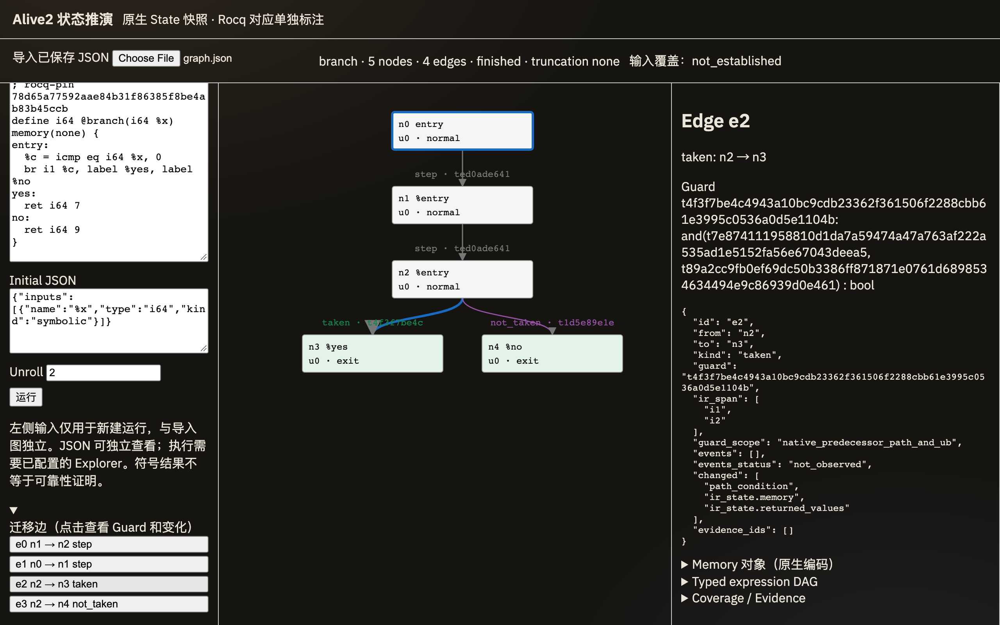
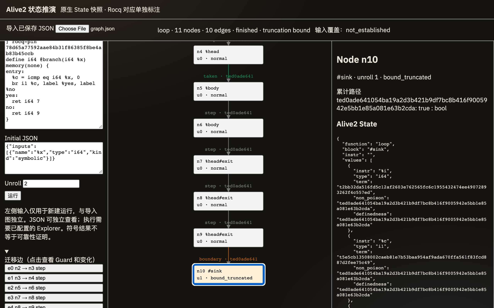
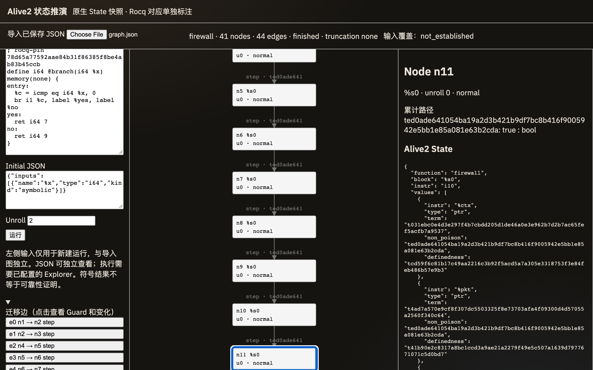
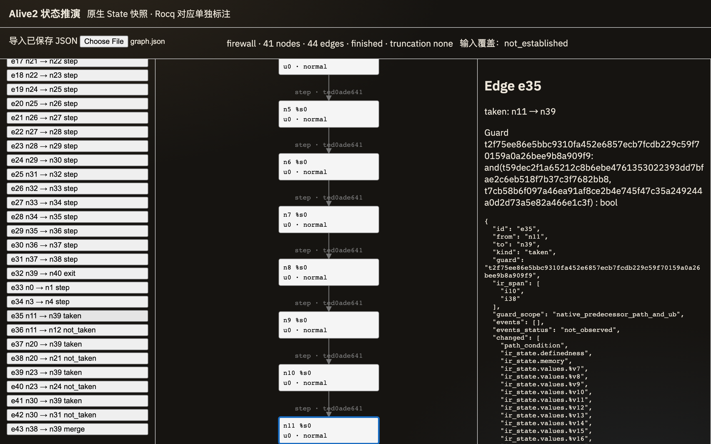

# PR8 delivery status

The goal is to recover G(R₀) from actual Alive2 execution and compare concrete checkpoints with independently executed Rocq ISA states. This revision implements the native graph-export portion. **The complete goal is not met.** Concrete initialized input objects, full dynamic source-state embedding, and full Rocq correspondence remain incomplete. PR8 must not be described as fully accepted or formally verified.

## Implementation

The branch merges PR7 head `39bdc4be19ba6432ba7461253e55762225167547` without changing that branch. Both `alive2-load` and `alive2-explore` use the extracted PR7 parser and validation code in `alive_file.cpp`. The duplicate parser and unused `parse_single` changes were removed. Loader self-test, inspect, normalize and smoke remain available.

The CLI initializes native inputs, calls native unrolling and symbolic execution, and observes cached SSA values, native predecessor paths, definedness, preconditions, axioms, function-call preconditions, block arrays and disjoint return alternatives. Ordinary nodes represent a native State after one instruction. They retain Alive2's native merged symbolic-state semantics. Boundary nodes retain separate actual predecessor snapshots. This is not an independent path-enumerating executor.

The exporter traverses the native Z3 AST. Supported terms have typed structural SHA256 IDs, canonical commutative argument order and a canonically sorted term table. Unsupported native expressions remain explicit. Atomic output publication occurs only after successful serialization. Missing input bindings fail instead of becoming zero.

Origin revision 2 metadata from PR7 remains intact. Optional `register-bindings-v1` checkpoints add static before/after R0–R10 bindings. The observer uses declared definitions and compiler-generated statements, including block-qualified revision 2 records. Unmapped clones stay unmapped. It does not infer registers from SSA names.

The viewer imports saved JSON, draws branches and unroll instances, and supports node/edge selection, Guard inspection and complete exported-state inspection. Rocq state is explicitly null/unsupported. The HTTP interface remains a thin CLI wrapper. Its execution runs off the async worker, temporary directories are removed, and retained results are bounded to 64 runs. Process-local results are ephemeral and oldest retained runs may be evicted.

## Correctness and trust boundaries

- Function attributes, Helper signatures, Phi types/predecessors, dominance, reachability and pins use the unchanged strict PR7 validation semantics.
- `State::getPath` and `getJumpCond` supply cumulative native conditions. The latter includes predecessor path and UB constraints. A separate local branch condition is not exported.
- Return accumulators are inspected through const observation accessors. Calling native finalizing return APIs during the walk was rejected after reproducing `bad_variant_access` on a second return.
- Native arrays, metadata and returned-memory alternatives are preserved. They are not a CompCert byte-memory embedding or a complete serialization of all private solver bookkeeping.
- Concrete integer inputs through 64 bits, stable defined symbolic inputs, explicit undef and poison are distinct. Concrete pointer objects and explicit environments are rejected. An experimental global-object substitution returned the expected byte but had false native definedness because ownership changed. It was reverted; memory attributes were not relaxed.
- The only local pinned-source changes are read-only observation accessors. No native instruction semantics, loop algorithm, axiom or Admitted declaration was added.
- No SMT feasibility query, all-input coverage proof, source-machine correspondence proof, observer proof, serializer proof or artifact proof is claimed. Coverage remains `not_established` even after normal return.

## Test Evidence

All commands below were run locally. Build products were outside the repository. Logs and generated artifacts are in `evidence/pr8/`.

| Check | Real result |
|---|---|
| Fresh vendored native `ir smt tools util` build, then Loader/Explorer build | Passed |
| `tooling/scripts/rust-ci.sh` with elan on PATH | Nightly fmt and clippy passed |
| `cargo test --manifest-path tooling/Cargo.toml -p ebpf-to-alive2` | 37 tests passed |
| `alive2-load --self-test` | Passed |
| `run-rust-file-e2e.py` | 17 compiled/loaded/structural round-trips; 3 native execution smokes |
| `compiler-structure.py --compiler … --loader …` | 7 independent structural fixtures passed |
| `run-explorer-tests.py` | 34 passed: 19 real executions, 11 CLI rejections, 4 validator mutation rejections |
| Python validator unit tests | 18 passed |
| HTTP integration with `ALIVE2_EXPLORE` pointing to this v2 build | 1 passed, including schema version assertion |
| `npm --prefix tooling/web run build` | Passed |
| `npm --prefix tooling/web test -- --run` | 65 passed, 3 failed in unchanged `formatExpr.test.ts` |
| Same web tests from archived original `dabe220` | Same 65 passed / 3 failures; baseline log retained |
| Pinned Rocq extraction build and `rocq-step --prove` | Driver self-check passed; not source-state correspondence |
| Browser | Imported actual branch, loop-boundary and firewall JSON; selected nodes/edges and captured screenshots |

The three existing web failures expect ABI names `a0`, `a3`, `ctx.data` but receive `real32:10`, `real32:13`, `context32:0`. They were reproduced from the original branch archive. They are not recorded as passing.

The Helper determinism regression runs `just_drop` repeatedly in separate processes and compares the complete resulting objects. Memory-return and boundary-predecessor assertions check actual native state. Invalid Origin hashes and duplicate slots are rejected. Graph hashes are checked against the archived JSON, not manually written execution fixtures.

## Corpus Results

Compiler/Loader checks cover all 17 pinned ELFs. These are conversion and structural test results, not source-state correspondence.

| Program | Instructions | Backedge present | Compiler/Loader |
|---|---:|---|---|
| bitswap | 68 | yes | converted / loaded / round-trip |
| bsort | 619 | no | converted / loaded / round-trip |
| buf | 46 | yes | converted / loaded / round-trip |
| case_mark | 104 | no | converted / loaded / round-trip |
| case_swap | 104 | no | converted / loaded / round-trip |
| div2 | 29 | no | converted / loaded / round-trip |
| fib | 41 | yes | converted / loaded / round-trip |
| firewall | 22 | no | converted / loaded / round-trip |
| fletcher32 | 402 | yes | converted / loaded / round-trip |
| helper_loop | 27 | yes | converted / loaded / round-trip |
| incr | 30 | no | converted / loaded / round-trip |
| just_drop | 33 | no | converted / loaded / round-trip |
| just_tx | 57 | no | converted / loaded / round-trip |
| memcpy | 73 | no | converted / loaded / round-trip |
| merge_try | 16 | no | converted / loaded / round-trip |
| square | 30 | no | converted / loaded / round-trip |
| xdp_drop | 21 | no | converted / loaded / round-trip |

Four real programs were also executed by Explorer with explicitly supplied symbolic inputs and their actual Origin files. These runs do not supply concrete input objects or a fixed concrete Helper implementation.

| Program | Nodes | Terms | Truncation | Rocq comparison |
|---|---:|---:|---|---|
| just_drop | 70 | 947 | none | unsupported |
| firewall | 41 | 665 | none | unsupported |
| helper_loop | 109 | 1105 | bound, unroll 2 | unsupported |
| xdp_drop | 34 | 520 | none | unsupported |

## Actual graph examples

The screenshots below show saved Explorer output imported into the running application. They are browser captures, not design files.









Saved graph JSON is under `evidence/pr8/graphs/`. `explorer-tests.json` graph paths are relative to that directory. Four real program inputs and Origin files are under `evidence/pr8/programs/`. Compiler/Loader evidence includes input hashes, sections, entries, instruction counts, backedges and output hashes. The recorded binary hashes identify the tested binaries; they do not promise bit-identical compiler binaries across toolchain versions.

There is no valid Rocq State detail or concrete checkpoint comparison example to show. All nodes expose `rocq_ebpf: null` and an explicit unsupported reason. Displaying a made-up TLS_State would misrepresent the implementation.

## Known Limitations and Remaining Work

1. **Initial/environment incomplete.** Concrete pointer identity, initialized input-memory objects, map contents, context layout and fixed Helper environments require a native initializer that preserves ownership and access rules. Symbolic pointers are supported; object files are rejected.
2. **Source checkpoint embedding incomplete.** Static R0–R10 bindings do not recover dynamic PC, RAX, call frames, code_id, tail_call_count, source byte memory or events. Loop clones can remain unmapped.
3. **Rocq correspondence absent.** The existing extracted driver projects R0–R9 and invokes `exec_instr` with empty stack, `None` code_id and zero tail count at every step. It discards corresponding Next fields. It must thread and export the full `TLS_State`, then compare it against independently initialized source checkpoints. Its DIV self-check does not establish PR8 correspondence.
4. **Symbolic coverage/proof absent.** No solver partitions the complete input domain. Frontier, return and sink observations are not a completeness theorem. Native State merges remain visible; no separate execution engine enumerates paths.
5. **Observation incomplete.** Events are `not_observed`; unsupported SMT types remain marked. Native Memory arrays are not complete source memory. Observer, checkpoint and serializer correctness remain implementation trust boundaries.
6. **Verification limitations.** Existing ABI formatting tests fail. The Python graph-cycle checker is recursive and is not intended for adversarially deep graphs. The API's corpus endpoint is an empty compatibility response. No SSE, lifecycle scheduler or corpus service was added.
7. **Tooling limitations.** Registered Pi resources lack cursor-team-kit `/deslop` and `control-cli`. Those commands were not run. Actual CLI, build and browser checks are recorded instead, without claiming those plugin gates passed.

Stage A is complete. Stage B implements native execution and observation. Stage C implements the exported protocol but lacks concrete object/environment initialization. Stage D remains incomplete. Stage E provides the viewer, real artifacts, validation and review, but cannot demonstrate a full Rocq state or correspondence that does not exist.

Independent review used a fresh `poteto-agent` requested as `magpie/group/qwen4`; runtime confirmed the resolved agent type. The reviewer's underlying vendor identity was not independently exposed, so cross-vendor independence is not asserted. Its reproducibility finding was fixed and the added regressions pass. The review is not approval of the missing acceptance scope. Details are in `.audit/pr8-state-explorer.tsv` and `evidence/pr8/review.md`.

## Reproduction

Prerequisites are C++20, CMake, re2c, pkg-config, Z3, OpenSSL, json-c, Rust nightly, Lean/elan for the workspace checks, and the existing web dependencies. Rocq additionally requires the documented `linux-ebpf` opam switch and pinned extraction dependencies.

Run from the repository root. Choose an external build directory.

```sh
build_root="$(mktemp -d)"
cmake -S alive2/third_party/alive2 -B "$build_root/native" \
  -DBUILD_TV=OFF -DCMAKE_BUILD_TYPE=Release
cmake --build "$build_root/native" --target ir smt tools util -j 4
cmake -S alive2 -B "$build_root/front" -DALIVE2_BUILD="$build_root/native"
cmake --build "$build_root/front" --target alive2-load alive2-explore -j 4
cargo build --manifest-path tooling/Cargo.toml -p ebpf-to-alive2
"$build_root/front/alive2-load" --self-test
python3 alive2/tests/run-rust-file-e2e.py \
  --compiler tooling/target/debug/ebpf-to-alive2 \
  --loader "$build_root/front/alive2-load" \
  --index alive2/corpus/snapshot.toml --out-dir "$build_root/corpus"
python3 alive2/tests/compiler-structure.py \
  --compiler tooling/target/debug/ebpf-to-alive2 --loader "$build_root/front/alive2-load"
python3 alive2/tests/run-explorer-tests.py \
  --explorer "$build_root/front/alive2-explore" \
  --loader "$build_root/front/alive2-load" \
  --corpus-out "$build_root/corpus" --out-dir "$build_root/graphs"
python3 -m unittest discover -s contracts -p test_validate_state_graph.py
tooling/scripts/rust-ci.sh
cargo test --manifest-path tooling/Cargo.toml -p ebpf-to-alive2
ALIVE2_EXPLORE="$build_root/front/alive2-explore" \
  cargo test --manifest-path tooling/Cargo.toml -p server alive2_runs::tests
npm --prefix tooling/web run build
npm --prefix tooling/web test -- --run
cmake --build "$build_root/front" --target rocq-step
"$build_root/front/rocq/rocq-step" --prove
```

The CLI remains independent of ELF and HTTP:

```sh
"$build_root/front/alive2-explore" run program.alive \
  --initial initial.json --unroll 2 --graph-out graph.json \
  --origin origin.json
python3 contracts/validate_state_graph.py graph.json
```

Use the **Prove It Works** principle here by checking the actual exported JSON and browser import. A successful build alone does not establish execution fidelity or the missing Rocq correspondence.
