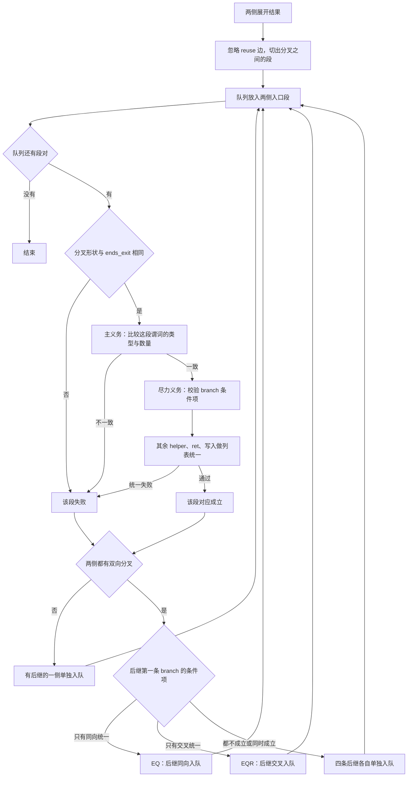

# 分支臂关联

比较树在每个双向分叉上只保留两种后继接线。接线由臂条件的规范相等义务决定：同向接线要求两侧条件相等，交叉接线要求一侧条件等于另一侧条件的对偶。恰好一种义务成立才采纳该接线。两种都不成立或同时成立时，该分叉失败。

本文只规定比较树的后继对应。它不修改 [CrossPred 相等](../Predicate/跨架构谓词.md#相等)，也不建立行为等价。`claim` 保持 `crossPred`，`behavioralEquivalence` 保持 `notEstablished`。

## 来源与取舍

Necula 的翻译验证把二元分支的对应分成同向（EQ）与反向（EQR）：同向要求两侧条件同时成立或同时不成立，反向要求一侧条件是另一侧的否定。Dahiya 与 Bansal 的联合转移图要求联合边上的两侧边条件等价，条件不成立则回溯。本文采用这两种候选和「条件必须被证明」这一接受规则。

本文不搜索复合边，不判断分支被删除后条件恒真或恒假，也不重排析取项。这些情形在下面的不完备范围里封闭失败。

## 输入

输入是[跨架构比较](跨架构比较.md#输入与对应假设)的两份展开结果，并沿用假设 C-A。比较树先按现行段构造阅读展开图：忽略 `reuse` 边；从入口或一条臂出发，沿唯一后继前进，直到节点同时具有 `taken` 与 `not_taken` 后继、到达 `exit`，或没有后继。这样得到的直线观察列称为段。段上的观察是该段节点相对父节点的局部谓词增量，次序是段内生成次序。局部增量的定义见[局部观察列表](../Predicate/跨架构谓词.md#局部观察列表)。

段的进入方向 \(d\) 属于 \(\{\mathrm{Taken},\mathrm{NotTaken}\}\)；入口段没有进入方向。双向分叉段还带两个后继段，分别由 `taken` 与 `not_taken` 进入。

## 匹配流程

同输入则同谓词。一次比较的对象是两个分叉之间的那段谓词，不是单条 branch 的条件项。

义务分成两层：

1. **主义务。** 两侧这段谓词的类型与数量一致。类型是 `helper`、`branch`、`ret`、`mapWrite`、`packetWrite`。数量按类型分别计。这一层决定段是否对应。
2. **尽力义务。** 在类型与数量已经一致之后，再校验 `branch` 的条件项是否同向统一，或是否互为补关系。这一层失败不拆开已经成立的段对应，也不改写后继接线。条件项对不上时，该段仍保留主义务的结果，并记下尽力义务未完成。

`align_trees` 的现行遍历如下。图中「branch 条件项」那一步在代码里仍是硬失败：`segment_match` 要求同向与补关系恰好一种统一成功，否则整段失败。它还没有实现上面的尽力义务。

分叉接线读的是后继段的第一条 `branch`，也就是下一段的入口条件。现行 `choose_wire` 把这次统一当作接线的通过条件：恰好 EQ 或恰好 EQR 才把后继配成一对。按上面的义务划分，类型与数量才决定有没有这条分叉；入口条件项的统一同样属于尽力义务，对不上时保留分叉、不交叉后继。

段内后续 `branch` 的补关系在现行代码里不交叉图后继。尽力义务沿用这一点：补关系只记录两个编译器把同一条已经走进的路径写成了互补条件，不把 `ret` 或 `lookup` 挪到另一条臂。

## 臂条件与对偶

**定义（臂条件）。** 段 \(S\) 的臂条件 \(b(S)\) 是 \(S\) 上第一条 `branch` 观察。若 \(S\) 有进入方向，这条观察的方向必须等于该进入方向。没有 `branch` 观察时，臂条件不存在。

Branch 观察的方向表示该方向上所记条件成立。Taken 与 NotTaken 上的关系符互为补关系，生成规则见[Branch 谓词](../Predicate/Branch谓词.md#触发逻辑)。

**定义（条件对偶）。** 对规范 branch 观察 \(p\)，\(\mathrm{dual}(p)\) 是把条件中的关系族换成其补关系、并按下列定理交换操作数次序后得到的观察；方向字段先不改变。

- 关系族与方向布尔的对偶保持规范关系，定理为 `cross_rel_dual`。
- 顺序族的操作数交换由 `rel_gtu_swap`、`rel_leu_swap`、`rel_geu_swap`、有符号伴随定理及 `rel_explicit_dual_swap` 覆盖。相等族 `eq` 与 `ne` 互为补关系，操作数次序不变。

对偶只使用这些已证明的关系变换。不在上述定理中的条件形没有 \(\mathrm{dual}(p)\)，交叉接线的义务随之不成立。

统一前把两侧 branch 的方向强制写成比较树边的同一方向。方向强制只消除 [CrossBranch 保留方向](../Predicate/跨架构谓词.md#规范化定义)带来的方向字段差异；它不改变关系族。位置不参与规范 branch 的相等，定理为 `cross_branch_position`。

## 分叉接线

设已配对的两段都有 `taken` 与 `not_taken` 后继。后继段记为 \(T_s(d)\)，其中 \(s\in\{L,R\}\)，\(d\) 为进入该后继的方向。

**定义（EQ）。** 同向配对 \(\{T_L(\mathrm{Taken}),T_R(\mathrm{Taken})\}\) 与 \(\{T_L(\mathrm{NotTaken}),T_R(\mathrm{NotTaken})\}\)。每一对后继的臂条件都必须存在。强制为同一方向后，`lean_cross_pred_unify` 对这一对臂条件返回 `ok && pass`。

**定义（EQR）。** 交叉配对 \(\{T_L(\mathrm{Taken}),T_R(\mathrm{NotTaken})\}\) 与 \(\{T_L(\mathrm{NotTaken}),T_R(\mathrm{Taken})\}\)。每一对后继的臂条件都必须存在。臂条件已经是该方向上成立的条件，交叉后直接比较这两条条件，不再对其中一侧取对偶；否则一对互补臂（例如 `ltu` 与 `geu`）会在对偶之后又变得相等，EQ 与 EQR 同时成立。强制为比较树该边的同一方向后，两对后继分别调用 `lean_cross_pred_unify`，两次都返回 `ok && pass`。

**接受条件。** 恰好 EQ 成立时采用同向后继。恰好 EQR 成立时采用交叉后继。两种都不成立，或两种都成立，该分叉的接线失败，不继续猜测。副作用所在的臂、子段末尾的关系名、固定的关系名对照表，都不参与这个决定。

两种都成立时，两侧臂条件在该统一器下既等于对方又等于对方的对偶，条件退化。此时没有唯一接线。

## 段内其余观察

后继配对只用后继段的第一条臂条件。段上这条臂条件之后的观察按生成次序单独对齐，不再改写后继配对。

设两侧剩余观察为 \(u_1,\ldots,u_m\) 与 \(v_1,\ldots,v_n\)。从左到右消费：

- 两侧下一条都是 `branch` 时，先按 EQ 的统一方式比较；不成立再对右侧取 \(\mathrm{dual}\) 后比较。恰好一种成立则同时消费这两条，并记录该分支在本段路径上是同向还是对偶。两种都不成立或都成立时，本段失败。
- 这一步的对偶不交叉本段的图后继。它只说明两个编译器把已经走过的同一条路径记成了互补关系。
- 其余 `helper`、`ret`、`mapWrite`、`packetWrite` 不套用对偶。它们与另一侧剩余观察组成局部列表，按[保序最大对齐](../Predicate/跨架构谓词.md#保序最大对齐)交给同一个统一入口。统一不成功则本段失败。

臂条件缺失的一侧不能与有臂条件的一侧配对。空观察列不是通配。

## 遍历

从两侧入口段组成的一对开始。

1. 若两侧都有双向后继，按[分叉接线](#分叉接线)选择唯一配对，再对两条臂递归。
2. 先做[段内其余观察](#段内其余观察)。段内失败则这一对段失败；失败不回退到另一种分叉接线。
3. 只有一侧有双向后继，或某一侧的臂条件缺失，该对失败。
4. 两侧都没有后继时，只做段内对齐。

同一段对只访问一次。展开图有限，遍历终止。

## 相对可靠的结论

**命题（接线的条件对应）。** 假定 `lean_cross_pred_unify` 返回 `ok && pass` 时，两侧被比较的规范观察在所给方向强制下结构相等。则：

- 采纳 EQ 时，两条同向后继的臂条件规范相等。
- 采纳 EQR 时，左侧一条臂的条件与右侧交叉臂的条件规范相等。两条臂各自记录的是该方向上成立的条件，所以相等表示同一条件被接到了互补的展开边上。
- 段内某条后续 branch 以对偶方式对齐时，该结论同样只覆盖这一对 branch，不覆盖段上其余观察，也不改写图后继。

**证明。** 接受条件要求唯一一种接线的两侧义务都通过统一入口。EQ 与 EQR 的义务都是方向强制后的臂条件统一；EQR 只改变后继配对，不改写条件。段内对偶分支才对右侧取 \(\mathrm{dual}\)，且不读取图后继；该变换由[条件对偶](#臂条件与对偶)所列补关系保持「该方向上成立」的规范条件。统一入口的可靠性假设把 `pass` 变成规范结构相等。\(\square\)

该命题不给出模拟关系，不给出路径条件的全称等价，也不把比较树的 `pass` 提升为行为等价。统一入口本身的可靠性仍归[输出匹配对可靠性](../Predicate/跨架构谓词.md#保序最大对齐)。

## 不完备时的封闭失败

下列输入本算法直接失败，不另设接线：

1. **统一器覆盖不足。** 义务在规范相等的意义下成立，但统一入口没有返回 `pass`。失败保持在该段。
2. **同一段上的析取重排。** 多条 branch 分别是同一析取的不同项，例如 VLAN 的 `129` 与 `43144`。后一项的对偶不是前一项。段内按次序对齐失败。不把两个 TPID 收成同一个条件。
3. **一侧多出或省掉一个真实分支。** 包括界限检查被拆开、融合，以及一条返回被写进分支所在段、另一侧仍把该返回放在后继段上。不证明该分支恒真或恒假，也不把返回与后继段配成一对。
4. **复用边。** 段构造不读 `reuse`。被复用接走的臂没有局部观察时，空臂与非空臂的义务失败。
5. **退化条件。** EQ 与 EQR 同时成立时失败。

封闭失败是本算法的结果，不是再调用副作用位置或关系名对照表的信号。

## 例子：just_drop 的 IPv4 判断

下列形状来自 2026-10-17 对 `just_drop` 的一次双架构比较树测量，budget 1024，两侧展开状态均为 `complete`。它只说明本算法在该测量上的判定，不是定理的实例证明。源程序在 VLAN 处理之后判断 `h_proto == bpf_htons(ETH_P_IP)`，常元为 `8`，见 `libbpf-mcu/tests/xdp/just_drop.c`。

测量中与本例有关的段是：

| 段 | 进入方向 | 左侧局部观察 | 右侧局部观察 | 后继 |
| --- | --- | --- | --- | --- |
| 2 | not_taken | `geu +18`，`ne 43144`，`eq 129` | `geu +18`，`ne 129`，`eq 43144` | taken → 3，not_taken → 4 |
| 3 | taken | `ltu`，`ret 1` | `ltu`，`ret 1` | 无 |
| 4 | not_taken | `geu +18`，`ne 8`，`ret 1` | `geu +18`，`eq 8` | taken → 5，not_taken → 6 |
| 5 | taken | 空 | `ltu +38`，`ret 1` | 无 |
| 6 | not_taken | 空 | `geu +38`，lookup | taken → 7，not_taken → 8 |

段 2 的两个后继入口臂分别是段 3 的 `ltu` 与段 4 的 `geu +18`。两侧同向统一成立，交叉后 `ltu` 与 `geu` 不统一。分叉接线取 EQ。

段 4 作为段 2 的 not_taken 后继，入口臂 `geu +18` 已经用于上一段的接线。剩余 branch 是左侧 `ne 8` 与右侧 `eq 8`：同向统一不成立，右侧取对偶后为 `ne 8`，统一成立。这一对偶只记录同一条已进入的路径被记成互补关系，不交叉段 4 的后继。

段 4 上对偶分支之后，左侧残留 `ret 1`，右侧没有残留观察。列表统一失败。段 4 的后继入口臂在左侧不存在，EQ 与 EQR 都没有臂条件，该分叉失败。右侧段 5–8 因此没有左侧对应段。

段 2 自身在入口臂 `geu +18` 之后还剩 `ne 43144, eq 129` 与 `ne 129, eq 43144`。相邻项既不相等，也不是对方的对偶。段内对齐失败。这是析取项次序不同，属于[不完备时的封闭失败](#不完备时的封闭失败)第 2 条。

## 现行实现

`tooling/server/src/pred_tree.rs` 的 `align_trees` 按本文选择后继：`choose_wire` 只在 EQ 与 EQR 恰好一种成立时配对后继，否则两侧后继分别单独成段。段内观察由 `segment_match` 按同向或补关系消费 branch，其余观察交给 `lean_cross_pred_unify`。补关系只翻转规范条件的关系族（`eq`/`ne`、`ltu`/`geu`、`leu`/`gtu` 及有符号、位测试的对应补），不交换操作数。

上述 `just_drop` 测量发生在这次替换之前。当时 `should_swap_polarity` 没有交叉段 4，`both_branch_only` 把段 2 标为 `pass`，比较树 `fail=5`。那两个宿主规则已经删除。替换后同一次双架构输入为 `fail=6`：段 2 与段 4 失败，段 5–8 因分叉义务不成立而各自只有右侧。段 3 仍为 `pass`。
