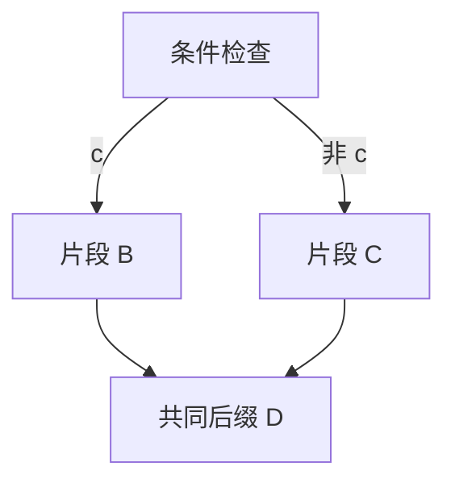
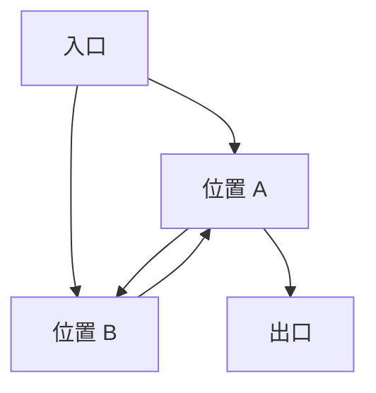

# 代数程序分析：图结构、路径表达式与语义解释

代数程序分析把图上的路径问题拆成两个步骤：先构造一个紧凑表达式，表示指定起点到终点的全部图上路径；再解释表达式中的原子操作及组合，得到所关心的程序行为。

本文说明这套方法的数学含义、构造算法、图上可能出现的情况，以及它与 Expr、Predicate 的连接。路径与节点的具体类型暂不定义。`common-math.md` 中已有的对象继续按原文解释；本文不确定分类器的总体架构或最终输出类型。

## 1. 两种图分别表示什么

| 图 | 节点代表什么 | 连线代表什么 | 是否有环 |
| --- | --- | --- | --- |
| 程序连接图 | 程序位置或指令片段边界 | 允许的后继连接，携带操作或条件标签 | 可以有环 |
| 路径表达式 DAG | 原子操作、顺序、选择、重复等子表达式 | 表达式对其子表达式的引用 | 没有环 |

这里只说明节点的数学角色，不规定它们的字段。操作放在程序图的边上，是代数路径算法的一种标准表述；指令原本附在位置上时，也可以转换为等价的带标签连接。转换时不能丢失指令内容和观察事件。

程序图中的一个循环，会在结果表达式中变成重复操作。重复操作引用循环体，但存储结构不必用回边表示重复。因此，「最终采用 DAG」不等于「原程序只能无环」。

多个表达式引用同一个子表达式，表示结构共享；它不表示多次执行到达该片段时具有相同 Expr。

本方法首先处理有限程序图。已知的间接跳转目标可表现为多条连接；未解析的目标不应被当成没有后继。无界调用栈与递归需要额外的调用语义，不能仅凭有限的函数位置图就保证调用、返回配对正确。

## 2. 路径表达式的代数

以下符号表示路径结构，不是寄存器数值运算，也不是 Expr 集合的覆写操作。

| 表示 | 含义 |
| --- | --- |
| A、B 等原子标签 | 一条指定连接所携带的操作；也可引用一个已经组成的片段 |
| \(A+B\) | 选择 A 或 B，保留二者的路径 |
| \(A\cdot B\) | 先经过 A，再经过 B |
| \(A^\ast\) | A 重复任意有限次，包括零次 |
| 0 | 没有路径 |
| 1 | 只有一条空路径，经过零个操作 |

这里讨论的路径允许重复经过位置和连接。循环产生的执行属于这种路径，不能把路径限定成「各位置最多经过一次」。

如果只解释图上连接的序列，则：选择是路径集合的并集，顺序是序列连接，重复是所有有限次连接的并集。0 是空集合，1 是只包含空序列的集合。1 不表示程序终止；它只是顺序组合的单位。

因此，下列等式有直接的集合解释：

\[
A+(B+C)=(A+B)+C,\qquad A+B=B+A,\qquad A+A=A,
\]

\[
(A\cdot B)\cdot C=A\cdot(B\cdot C),
\]

\[
A\cdot(B+C)=A\cdot B+A\cdot C,
\qquad (A+B)\cdot C=A\cdot C+B\cdot C,
\]

\[
A+0=A,\qquad A\cdot1=1\cdot A=A,
\qquad A\cdot0=0\cdot A=0.
\]

选择可以交换，执行顺序一般不能交换。\(A+A=A\) 只去除重复的同一可能路径，不意味着执行两次 A 与执行一次 A 相同。

重复满足展开关系：

\[
A^\ast=1+A\cdot A^\ast=1+A^\ast\cdot A.
\]

这些关系属于 Kleene 代数的基本性质。星号表示所有有限次重复，不包括一条无限执行本身。

## 3. 条件分支怎样进入代数

写作 \([c]\) 的条件测试，表示在该检查发生时，只允许条件 c 成立的执行通过；条件不成立时，该方向没有可行执行。它本身不修改寄存器，也不产生观察事件。

条件分支可表示为：

\[
[c]\cdot B+[\neg c]\cdot C.
\]

共同前缀 A 与共同后缀 D 则得到：

\[
\boxed{A\cdot\bigl([c]\cdot B+[\neg c]\cdot C\bigr)\cdot D.}
\]

这个表达式保留两个分支，A、D 无需在每条完整路径中复制。若展开，按分配律就得到两条从前缀到后缀的路径。

带测试的 Kleene 代数（KAT）为条件检查提供布尔运算，例如同一次检查的 c 与非 c 不能同时成立。但两次检查之间若有操作修改条件所读的值，不能据此把整条路径判断为矛盾。

图上路径的表达式可以包含语义上不可行的路径。条件与操作的解释负责排除这些路径；图上路径语言是正则的，不意味着经过数据条件筛选后的行为也一定具有同样简单的表示。

如果分支选择还需要生成分类器的 Predicate，必须另行保留该观察内容。标准 KAT 测试只筛选执行，不能直接替代带观察效果的操作。

## 4. 程序连接图会出现哪些情况

### 4.1 局部连接

以下情况描述连接结构，不规定节点类型。判断终止、错误或未解析目标，还需要连接标签或解释结果。

| 情况 | 图上含义 | 代数处理 |
| --- | --- | --- |
| 顺序执行或直接跳转 | 当前片段连接到一个后继 | 顺序组合；前向、后向由实际连接决定 |
| 条件分支 | 有两个带互补条件的选择 | 条件测试加选择 |
| 两个分支指向同一位置 | 两条不同条件连接具有相同终点 | 保留两个选择；不能仅凭终点相同删除条件或事件 |
| 有限多目标跳转 | 目标已知且数量有限 | 对相应带条件连接作有限次选择 |
| 多个前驱到达同一位置 | 汇合 | 共享后续结构；各前驱传入的语义输入仍可不同 |
| 自跳转 | 当前位置连接回自身 | 重复 |
| 没有后继 | 正常结束、拒绝或缺失绑定等可能情况 | 必须先区分含义，不能仅凭出度为零判为正常结束 |

一个位置可以同时是汇合点、分支点和循环内的位置。这些情况可以重叠，不构成互斥的指令分类。

### 4.2 分支汇合与不汇合

最简单的汇合如下：

不要求所有分支都有共同后缀。两个分支可以到达不同出口，也可以一侧退出、另一侧进入无出口区域。

对于多个出口，可以分别计算到各出口的表达式，也可以增加公共查询终点，把出口连接到它。使用公共终点时，必须保留原来的出口身份或观察标签。否则，正常返回、拒绝及不同返回内容可能被混淆。

直接从起点无法到达的位置，不出现在以该起点为入口的路径表达式中。某个位置可达但无法到达选定出口时，也不会出现在到该出口的完整路径中；这不代表它从未被执行。

### 4.3 自环、一般循环与嵌套循环

自环是一般循环的最小情形。多位置循环可以在位置消去后组成一个可重复片段；嵌套循环可以表现为包含重复子表达式的重复表达式。

有单一条件入口和退出检查的循环，可写作：

\[
([c]\cdot B)^\ast\cdot[\neg c]\cdot D.
\]

这里每轮都重新解释条件检查。若 B 更新条件所读的寄存器，各轮条件不应被固定成首次检查时的值。

循环也可能有多个退出连接、提前返回，或循环体内部再次分支。它们仍由顺序、选择和重复组合，但不一定能直接写成上面这一种简单形式。

### 4.4 多入口循环与交叉回跳

机器指令图不一定具有整齐的父、子循环结构。例如，入口可以直接进入互相可达的 A 或 B：

区域 A、B 有两个入口。不能要求先找出一个唯一的父路径或唯一循环头，才能处理这个区域。

通用位置消去算法能处理有限图中的这种结构，不依赖规则的 while 嵌套。结果可能具有较复杂的选择及重复组合。

### 4.5 用强连通分量统一理解循环区域

强连通分量（SCC）是一个最大的互相可达区域。区域中任意两个位置都能沿图中的连接互相到达。

有限图中的每个位置属于一个 SCC。循环区域包括多位置 SCC，以及带自环的单位置 SCC。把各 SCC 缩成一个点后，得到无环图：如果分量之间还有环，它们就能互相到达，本应属于同一个分量。

因此，一般有限图可以理解为：无环的区域间连接，加上各循环区域内部的结构。区域内部可以有多入口、多出口及复杂回跳，无需假定所有循环都具有唯一入口。

若一个可达循环区域没有任何离开它的连接，它不能产生通向外部出口的完整路径。但数据条件可能使某些连接不可行，也可能使执行被拒绝；仅凭 SCC 不能宣称该区域内的所有实际执行都无限运行。

## 5. 从图得到路径表达式：位置消去

以下使用程序位置 a、b、k 说明算法。\(R_{ab}\) 是目前从 a 到 b 的路径表达式；这些路径的中间位置只允许使用已经消去的位置。

初始化时，\(R_{ab}\) 是 a 到 b 的直接连接标签之选择；没有连接就用 0。同一位置到自身还可以计入空路径 1。平行连接都保留，不因终点相同而合并成无条件连接。

若入口或出口本身参与循环，可增加新的查询起点和终点，并通过空连接接入原图。新起点、终点不参与消去；原有操作和出口区别仍保留。

准备消去 k 时，对仍保留且不同于 k 的位置 a、b，更新：

\[
\boxed{R_{ab}\;:=\;R_{ab}+R_{ak}\cdot(R_{kk})^\ast\cdot R_{kb}.}
\]

所有右侧表达式使用消去 k 之前的版本。

推导如下：

1. 新增可用的中间位置只有 k。
2. 不经过 k 的路径已经由旧的 \(R_{ab}\) 表示。
3. 经过 k 的路径分成：首次到达 k、有限次从 k 回到 k、最后从 k 离开到 b。
4. 对应三个片段分别是 \(R_{ak}\)、\((R_{kk})^\ast\)、\(R_{kb}\)。
5. 用选择连接旧路径与新增路径，随后删除 k。

这个不变量说明每次消去都保留所允许的全部有限路径。消去全部中间位置后，起点到终点的表达式就表示原图中二者之间的全部有限路径。

终止依据是待消去位置的数量有限，与程序是否终止无关。结果正确性也不依赖位置消去顺序；不同顺序可能产生大小和形状不同、但表示相同图上路径的表达式。

Kleene 算法提供经典路径表达式构造，Tarjan 算法是适用于程序图的另一条路线。构造过程中使用共享表达式 DAG，可以避免把重复子表达式反复复制为树。

## 6. 循环也可以理解为方程的最小解

设 X 表示从某处继续到出口的全部有限路径，A 表示绕回该处的一轮路径，B 表示离开该处通向出口的路径。

得到递归方程：

\[
X=A\cdot X+B.
\]

从没有路径开始逐步展开：

\[
0,\qquad B,\qquad A\cdot B+B,\qquad A\cdot A\cdot B+A\cdot B+B,\quad\ldots
\]

其并集是：

\[
\boxed{X=A^\ast\cdot B.}
\]

这是包含所有有限次绕回后退出的路径的最小解。「最小」按路径集合包含关系理解：任何满足方程的路径集合都必须包含 B、一次绕回后退出、两次绕回后退出等路径。

如果 B=0，最小解也为 0。这表示没有通向所选出口的有限路径；它不等于该程序没有执行或没有观察事件。一直绕回的无限执行不属于这个最小解中的有限完整路径。

这就是星号在消去公式中出现的数学原因：它把一个局部递归路径问题写成有限表达式。

## 7. 最终路径表达式 DAG 会有哪些情况

程序图的分支、回跳和多入口循环，经过构造后都可以落到以下表达式角色上。此表不规定最终节点字段或原子粒度。

| 表达式角色 | 引用的子结构 | 表示的路径 |
| --- | --- | --- |
| 原子操作或条件标签 | 无 | 一个基本操作或条件检查 |
| 0、1 | 无 | 无路径或空路径 |
| 顺序 | 两个片段，或其有限序列 | 依次经过各片段 |
| 选择 | 两个片段，或其有限集合 | 保留不同可能路径 |
| 重复 | 一个片段 | 任意有限次经过该片段 |
| 共享子表达式 | 可被多个父表达式引用 | 同一个结构用于不同组合位置 |

重复节点不是无限多份循环体，也不要求指向祖先节点。嵌套循环表现为重复子表达式中再次包含重复；多入口循环可能表现为重复和选择的复杂组合。

如果把全部选择展开，再把全部重复列举，有限 DAG 仍可能得到指数多条路径，甚至无限多条有限路径。因此，紧凑表示不意味着完整路径列举或语义求解具有同样的成本。

## 8. 表达式如何解释成程序行为

代数程序分析的第二步是选择语义解释。原子标签的含义可以是指令效果、带观察的行为关系，或某种分析摘要；组合操作需要按同一解释保持一致。

| 组合 | 精确行为解释 |
| --- | --- |
| 选择 | 保留两侧的可能行为 |
| 顺序 | 前一片段的输出作为后一片段的输入，连接其观察历史 |
| 重复 | 零次、一次、两次等有限次顺序解释的并集 |
| 0 | 没有可能行为 |
| 1 | 不改变输入，也不新增观察 |

在本会话的 Expr 模型中，共同后缀应保存处理规则。例如，两侧分别产生 `r = x + 1` 与 `r = x - 1`，后缀「观察 r」可以共享结构，但应在各自传入的 Expr 下生成不同观察。

选择不能把两侧的寄存器定义并成同时成立的定义。循环也不能每轮复用第一次得到的 Expr。单指令解释中生成的新项、外部调用绑定与观察内容，仍需按实际的解释次数和输入处理。

精确行为解释可以满足 Kleene 代数的组合规律，但有限大小的分析摘要不一定能精确实现全部操作，尤其是任意有限次重复。有些代数程序分析使用安全近似的循环摘要，此时得到的是行为的包容性近似，不能直接宣称精确相等。

因此，需区分三个结论：表达式准确表示图上路径；表达式按指令语义得到实际行为；分析摘要近似或精确表示这些行为。前一个结论不自动推出后一个结论。

## 9. 无限执行、错误与未知的含义

普通星号只表示有限重复，入口到出口表达式只说明可以到达所选出口的有限完整路径。如果需要保留无限执行中的观察，必须另行解释执行前缀或无限行为，不能用「无出口路径」替代「没有行为」。

正常返回、指令拒绝、未解析目标，以及因求解或预算限制而未完成，具有不同含义。图的表示或分析不能悄悄把后几种情况归为没有可行路径。

只有已证明矛盾的条件路径，才可以按不可行排除。路径条件未知或求解失败时，不能据此判定条件为假。

同样，`common-math.md` 中的有限历史集合不能直接等同于含星号的表达式含义：后者可能包含无限多条有限历史。这里说明两者的数学区别，不决定分类器最终采用哪一种输出。

## 10. 这套方法是否要求先定义状态

构造图上路径表达式时，不必先定义完整执行状态。它需要的是有限位置、带标签连接，以及所查询的起点和终点。

解释操作标签时，则必须知道片段需要什么输入、产生什么输出。文献常用状态关系或转换公式表达这些信息；这不要求分类器直接采用完整机器状态。

对现有定义，应先区分：

| 对象 | 含义 |
| --- | --- |
| 程序位置 | 接下来处理哪条指令 |
| 解释输入 | 当前可用的 Expr，以及条件或既定绑定等后续处理实际需要的信息 |
| 历史记录 | 某次处理已经产生的 Insn、Predicate、Expr 与后继信息 |

`common-math.md` 第 2.2 节的元组首先是历史记录。是否足以同时充当解释输入，要检查其内容及单指令处理所读取的信息，不能预先认定二者相同。

因此，可以先完整讨论图的拓扑和路径代数，再确定最小解释输入。状态的详细字段会影响语义解释、可行性和结果复用，但不会改变顺序、选择与有限重复这些结构操作的含义。

## 11. 参考文献

1. Zachary Kincaid、Thomas Reps、John Cyphert，*Algebraic Program Analysis*，2021。[论文](https://www.cs.wisc.edu/wpis/papers/Kincaid2021_Chapter_AlgebraicProgramAnalysis.pdf)。参考路径表达式、方程消去、语义解释及精确与近似分析的区别。
2. 同一教程的 [Introduction to Algebraic Program Analysis](https://research.cs.wisc.edu/wpis/talks/CAV21-Algebraic-Part1-regular.pdf) 演示材料。参考共享路径表达式 DAG 与图上路径问题。
3. Dexter Kozen，*Kleene Algebra with Tests and the Static Analysis of Programs*，2003。[论文](https://www.cs.cornell.edu/kozen/Papers/static.pdf)。参考条件测试、循环、关系及迹的解释，以及不终止计算的前缀。
4. LLVM，[Cycle Terminology](https://llvm.org/docs/CycleTerminology.html)。参考多入口循环及可约、不可约控制流。本文的通用图处理不要求唯一循环入口。
