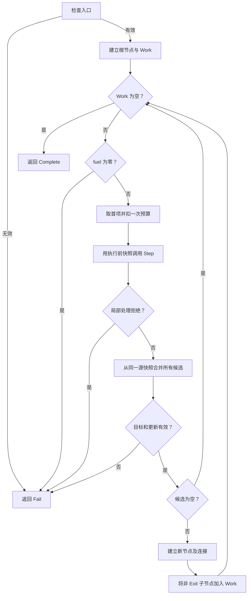

# 分类器共同数学定义

本文合并输入、输出历史结构、寄存器与符号运算定义、已约定的指令分类，以及带状态快照的节点、路径与有预算的展开算法。具体指令的值函数分别见 [RV32IMC 值函数](rv32imc-expr-value-functions.md) 和 [eBPF 值函数](ebpf-expr-value-functions.md)。本文使用数学集合、有限序列与函数；算法使用独立于编程语言的伪代码。新增的节点与算法定义为当前草案。

## 1. 记号与基本对象

### 1.1 集合与序列记号

对集合 \(A\)，定义其有限序列集合与有限子集集合：

\[
A^\ast=\bigcup_{m\in\mathbb N}A^m,
\qquad
\mathscr F(A)=\{B\subseteq A:\lvert B\rvert<\infty\}.
\]

这里 \(\mathbb N=\{0,1,2,\ldots\}\)，\(A^0\) 包含空序列。\(\times\) 表示笛卡尔积，\(\bigsqcup\) 表示保留类型标签的不交并。

### 1.2 统一名称

| 记号 | 含义 |
|---|---|
| \(\mathrm{Insn}\) | 原始指令集合 |
| \(\mathrm{Predicate}\) | 谓词集合，具体元素与解释待定 |
| \(\mathrm{Expr}\) | 寄存器关系标记集合 |
| \(\mathrm{Inst}_{\mathrm{next}}\) | 后继方向与目标节点引用，第 13 节定义 |
| \(\mathrm{Reg}_{k,w}\)、\(\mathrm{Reg}_w\) | 指定类型、位宽的寄存器集合；指定宽度的全部寄存器集合 |
| \(\mathrm{Const}_w\) | w 位常元集合 |
| \(\mathrm{Var}_w\) | w 位变元集合 |
| \(\mathrm{Term}_w\) | w 位符号项集合 |
| \(\mathrm{Op}_{(w_1,\ldots,w_n)\to w}\) | 指定输入、输出位宽的形式运算符集合 |
| \(\mathrm{Rel}_w\) | w 位值上的二元关系符号集合 |

这些名称分别在后文定义。全文不另用其他名称指代同一集合。

### 1.3 元素与参数记号

| 记号 | 含义与取值 |
|---|---|
| \(i\in\mathrm{Insn}\) | 一条指令，i 不作为数字索引或立即数 |
| \(p\in\mathrm{Predicate}\) | 一个谓词，p 不表示 PC 值 |
| \(e\in\mathrm{Expr}\) | 一个寄存器关系标记 |
| \(r_w\in\mathrm{Reg}_w\) | 一个 w 位寄存器标记 |
| \(t_w\in\mathrm{Term}_w\) | 一个 w 位符号项 |
| \(w\in W=\{32,64\}\) | 寄存器与符号项的位宽 |
| \(v,q\in\mathbb N_{>0}\) | 数值辅助函数的输入位宽、选定运算或截取位宽 |
| \(a,b,c\) | 位向量的数值；每个公式另行给出所属的 \(\mathbb B_q\) |
| \(\alpha\) | 寄存器标识，属于对应类型的 \(\mathcal I_k\) |
| \(\xi\) | 变元名称，属于对应位宽的 \(\Xi_w\) |
| \(f\) | 形式运算符 |
| \(\widehat f\) | f 对应的数值函数 |
| \(f^\star\) | f 对符号项的求解后应用 |
| \(G\)、\(G^\star\) | 已命名数值函数及其符号提升，如 ADD、Z |
| \(\bowtie\in\mathrm{Rel}_w\) | 一个关系符号 |
| \(\widehat{\bowtie}\) | 关系符号的数值解释 |
| \(j\) | 序列、函数参数或位位置的数字索引 |
| \(n\ge1\) | 运算符的参数个数 |
| \(m\in\mathbb N\) | 有限序列长度 |
| \(\varphi\) | 一个数学命题，用于指示函数 \(\mathbf1[\varphi]\) |

PC、SP 是寄存器标识。书写 w 位 PC 的数值与符号项时，分别使用 \(\pi\in\mathbb B_w\) 与 \(t_\pi\in\mathrm{Term}_w\)。具体指令中的已解码立即数、偏移使用 \(\iota,\delta\)，不占用 i。

## 2. 输入、输出与执行历史

### 2.1 原始指令

令指令编码宽度集合为

\[
W_{\mathrm{Insn}}=\{16,32,64\}.
\]

对正整数 q，令

\[
\mathbb B_q=\{0,1,\ldots,2^q-1\}.
\]

定义

\[
\mathrm{Insn}=
\bigsqcup_{w\in W_{\mathrm{Insn}}}
\bigl(\{w\}\times\mathbb B_w\bigr).
\]

一条指令携带编码位宽与对应位模式。这里的 \(W_{\mathrm{Insn}}\) 与寄存器位宽集合 W 是两个不同集合。

输入是原始指令的有限序列：

\[
\mathbf I=(i_0,\ldots,i_{m-1})\in\mathrm{Insn}^\ast.
\]

每个 \(i_j\) 是一条指令，j 才是序列位置。

### 2.2 历史项与输出集合

一项历史记录写作

\[
(i,\mathcal P,\mathcal E,\mathcal N)
\in
\mathrm{Insn}
\times\mathscr F(\mathrm{Predicate})
\times\mathscr F(\mathrm{Expr})
\times\mathscr F(\mathrm{Inst}_{\mathrm{next}}).
\]

其中 \(\mathcal P\) 是该项的谓词有限集合，\(\mathcal E\) 是 Expr 有限集合，\(\mathcal N\) 是后继信息有限集合。在第 17 节的路径投影中，\(\mathcal P,\mathcal E\) 采用该指令执行后的状态快照，因而也保留最后一条返回指令产生的信息。执行节点则采用指令执行前的快照；两种记录的时刻明确区分。

一条执行历史 h 是这些历史项组成的有限序列。成功输出是多条历史组成的有限集合：

\[
\boxed{
\mathcal H\in
\mathscr F\!\left(
\left(
\mathrm{Insn}
\times\mathscr F(\mathrm{Predicate})
\times\mathscr F(\mathrm{Expr})
\times\mathscr F(\mathrm{Inst}_{\mathrm{next}})
\right)^\ast
\right).
}
\]

历史内部保留执行顺序；各项中的三个集合及多条历史组成的输出集合使用集合语义。后继信息采用弱链表形式，是历史项携带状态的一部分，不要求每项包含完整机器状态。

Predicate 承载最终语义一致比较所选取的谓词信息。Expr 记录中间寄存器关系；不同架构的这些中间标记允许不一致。具体谓词及最终选取范围继续待定。

## 3. 三类寄存器、六种变体

令

\[
K=\{\mathrm{Real},\mathrm{Stack},\mathrm{Map}\},
\qquad W=\{32,64\}.
\]

Real、Stack、Map 分别表示真实寄存器、虚拟栈寄存器、虚拟 Map 寄存器。给定各自的标识集合 \(\mathcal I_k\)，定义

\[
\mathrm{Reg}_{k,w}
=
\{(k,w,\alpha):\alpha\in\mathcal I_k\},
\qquad
\mathrm{Reg}_w=
\bigsqcup_{k\in K}\mathrm{Reg}_{k,w}.
\]

以下构造名称是这些三元组的统一书写形式：

| 类型 | 32 位标记 | 64 位标记 |
|---|---|---|
| 真实寄存器 | \(\mathrm{Real}_{32}(\alpha)\) | \(\mathrm{Real}_{64}(\alpha)\) |
| 虚拟栈寄存器 | \(\mathrm{SW}(\alpha)\) | \(\mathrm{SR}(\alpha)\) |
| 虚拟 Map 寄存器 | \(\mathrm{Map}_{32}(\alpha)\) | \(\mathrm{Map}_{64}(\alpha)\) |

例如，\(\mathrm{SW}(\alpha)\) 就是 \((\mathrm{Stack},32,\alpha)\)，\(\mathrm{SR}(\alpha)\) 就是 \((\mathrm{Stack},64,\alpha)\)。

PC、SP 和通用寄存器名称均属于 \(\mathcal I_{\mathrm{Real}}\)。这里不区分 RV32 与 eBPF，也不增加架构寄存器类别。具体指令中的寄存器编号及别名由对应指令定义解释。

## 4. 常元、变元与符号项

### 4.1 常元与变元

对 \(w\in W\)，给定位宽对应的变元名称集合 \(\Xi_w\)，定义

\[
\mathrm{Const}_w=\{C_w(c):c\in\mathbb B_w\},
\qquad
\mathrm{Var}_w=\{V_w(\xi):\xi\in\Xi_w\}.
\]

\(C_w(c)\) 表示确定的 w 位值。\(V_w(\xi)\) 表示一个固定的符号值名称，不是对可变寄存器的引用。同名但位宽不同的变元仍是不同元素。

没有定义的寄存器不记录为某个特殊变元或常元。指令所需源项没有定义时，解析拒绝。

### 4.2 运算符与值函数

对 \(w_1,\ldots,w_n,w\in W\)，给定

\[
f\in\mathrm{Op}_{(w_1,\ldots,w_n)\to w},
\qquad
\widehat f:
\prod_{j=1}^{n}\mathbb B_{w_j}\longrightarrow\mathbb B_w.
\]

f 是形式符号；\(\widehat f\) 是确定且全定义的数值函数。已解码立即数、操作宽度及已明确的字节序可以作为运算符的固定参数。

已经命名的数值函数 G，对应形式符号记作 \(f_G\)，满足 \(\widehat{f_G}=G\)。这里不会因为外部调用的参数都是常元，就假定其返回值是可由这些参数决定的纯数值函数。

### 4.3 符号项

定义 \(\mathrm{Term}_w\) 为下列有限构造项的集合：

\[
t_w::=
C_w(c)
\mid V_w(\xi)
\mid f(t_{w_1},\ldots,t_{w_n}).
\]

每个子项的宽度与 f 的输入签名一致。常元、变元是两类叶子，函数应用保存它们之间的运算结构。

辅助数值函数可处理 8、16 位等数值；这不增加 Reg 或 Term 的位宽种类。只有输入、输出签名均落在 W 内的函数才直接提升为 Term 运算符；涉及其他宽度的数值步骤可组成输出为 32/64 位的指令值函数。

## 5. 求值与 solve

### 5.1 变元出现集合

令全部变元的集合为

\[
\mathrm{Var}=\bigsqcup_{w\in W}\mathrm{Var}_w.
\]

定义变元出现集合函数

\[
FV:\bigsqcup_{w\in W}\mathrm{Term}_w
\longrightarrow\mathscr F(\mathrm{Var})
\]

及其递归规则：

\[
FV(C_w(c))=\varnothing,
\qquad
FV(V_w(\xi))=\{V_w(\xi)\},
\]

\[
FV(f(t_1,\ldots,t_n))=\bigcup_{j=1}^{n}FV(t_j).
\]

### 5.2 无变元项的求值

对 \(w\in W\)，定义

\[
\operatorname{eval}_w:
\{t\in\mathrm{Term}_w:FV(t)=\varnothing\}
\longrightarrow\mathbb B_w,
\]

\[
\operatorname{eval}_w(C_w(c))=c,
\]

\[
\operatorname{eval}_w(f(t_1,\ldots,t_n))
=
\widehat f\bigl(
\operatorname{eval}_{w_1}(t_1),\ldots,
\operatorname{eval}_{w_n}(t_n)
\bigr).
\]

### 5.3 solve 与符号提升

\[
\operatorname{solve}_w:\mathrm{Term}_w\longrightarrow\mathrm{Term}_w,
\]

\[
\boxed{
\operatorname{solve}_w(t)=
\begin{cases}
C_w(\operatorname{eval}_w(t))&FV(t)=\varnothing,\\
t&FV(t)\ne\varnothing.
\end{cases}}
\]

定义

\[
f^\star(t_1,\ldots,t_n)
=
\operatorname{solve}_w(f(t_1,\ldots,t_n)).
\]

对已命名数值函数 G，统一记

\[
G^\star=f_G^\star.
\]

因此 ADD、Z 等名称用于数值函数；\(\mathrm{ADD}^\star\)、\(Z^\star\) 表示对应符号项的构造与 solve。输入、输出宽度由函数签名确定。

含有任何变元时，整个项保持原样，不进行局部常元折叠。例如含变元的 \(f(t_1,t_2)\) 即使某个子项不含变元，solve 仍直接返回整个原项，也不应用相消等代数恒等式。

所有源项表示指令发生前的值。多目标指令的输出使用同一组源项，目标寄存器随后更新不会改变已有项。

## 6. Expr 与关系符号

### 6.1 Expr 的结构

令 \(\mathbb T=\{\mathsf{true},\mathsf{false}\}\)。每个关系符号 \(\bowtie\in\mathrm{Rel}_w\) 有解释

\[
\widehat{\bowtie}:\mathbb B_w\times\mathbb B_w\longrightarrow\mathbb T.
\]

定义

\[
\boxed{
\mathrm{Expr}
=
\bigsqcup_{w\in W}
\left(\mathrm{Reg}_w\times\mathrm{Rel}_w\times\mathrm{Term}_w\right).
}
\]

元素记作

\[
e=(r_w,\bowtie,t_w),
\qquad
\text{通常书写为 }r_w\bowtie t_w.
\]

左侧始终是寄存器标记，右侧始终是同位宽符号项。普通等式 \(r_w=t_w\) 可用于寄存器定义，其他关系用于条件或约束；关系标记本身不自动成为 Predicate。

### 6.2 等式与有符号、无符号比较

对正整数 q 和整数 z，定义

\[
M_q(z)=z\bmod2^q,
\]

其中余数取 \(\mathbb B_q\) 中的非负代表。对 \(a\in\mathbb B_q\)，定义

\[
u_q(a)=a,
\qquad
s_q(a)=
\begin{cases}
a&a<2^{q-1},\\
a-2^q&a\ge2^{q-1}.
\end{cases}
\]

关系符号包括

\[
=,\ne,<_{u},\le_u,>_u,\ge_u,<_{s},\le_s,>_s,\ge_s.
\]

令 \(\diamond\in\{=,\ne,<,\le,>,\ge\}\) 表示通常整数关系。对 \(a,b\in\mathbb B_w\)，有

\[
\widehat{\diamond_u}(a,b)
\iff u_w(a)\diamond u_w(b),
\qquad
\widehat{\diamond_s}(a,b)
\iff s_w(a)\diamond s_w(b).
\]

等式与不等式的 u/s 解释相同，省略该下标。

### 6.3 选定位宽的比较与位测试

对 \(1\le q\le w\)，定义

\[
\widehat{\diamond_u^{[q]}}(a,b)
\iff M_q(a)\diamond M_q(b),
\]

\[
\widehat{\diamond_s^{[q]}}(a,b)
\iff s_q(M_q(a))\diamond s_q(M_q(b)).
\]

q=w 时可以省略上标。等式、非等式仍省略 u/s，写作 \(=^{[q]}\)、\(\ne^{[q]}\)。这样可以在同一个 64 位 Reg 标记上表达低 32 位比较。

位与函数 AND 的数值定义见第 7 节。定义

\[
\widehat{\mathrm{BITSNZ}^{[q]}}(a,b)
\iff \mathrm{AND}_q(M_q(a),M_q(b))\ne0.
\]

BITSZ 是其补关系。一般关系的补符号记作 \(\overline{\bowtie}\)，其解释为

\[
\widehat{\overline{\bowtie}}(a,b)
=
\neg\widehat{\bowtie}(a,b).
\]

例如 \(\overline{<_s}=\ge_s\)。这里 \(\neg\) 表示布尔否定。

### 6.4 Expr 的 solve

定义

\[
\operatorname{solve}_{\mathrm{Expr}}:
\mathrm{Expr}\longrightarrow\mathrm{Expr},
\]

\[
\operatorname{solve}_{\mathrm{Expr}}(r_w,\bowtie,t_w)
=
(r_w,\bowtie,\operatorname{solve}_w(t_w)).
\]

它仅处理右侧项，不通过左侧 Reg 标记自行判定关系真假。

## 7. 共同数值函数

本节命名的函数均为数值函数 G；其符号提升 \(G^\star\) 按第 5 节定义。凡未另行说明，下列 a、b 属于 \(\mathbb B_w\)，w 属于 W。

### 7.1 算术

ADD、SUB、MULLO 的签名为 \(\mathbb B_w^2\to\mathbb B_w\)；NEG、ID 的签名为 \(\mathbb B_w\to\mathbb B_w\)。

\[
\mathrm{ADD}_w(a,b)=M_w(a+b),
\qquad
\mathrm{SUB}_w(a,b)=M_w(a-b),
\]

\[
\mathrm{MULLO}_w(a,b)=M_w(ab),
\qquad
\mathrm{NEG}_w(a)=M_w(-a),
\qquad
\mathrm{ID}_w(a)=a.
\]

### 7.2 按位逻辑

对 \(a\in\mathbb B_q\) 与 \(0\le j<q\)，定义第 j 位：

\[
\beta_j(a)=\left\lfloor a/2^j\right\rfloor\bmod2.
\]

AND、OR、XOR 的签名为 \(\mathbb B_q^2\to\mathbb B_q\)，其中 q 可为正整数辅助位宽：

\[
\mathrm{AND}_q(a,b)=
\sum_{j=0}^{q-1}\beta_j(a)\beta_j(b)2^j,
\]

\[
\mathrm{OR}_q(a,b)=
\sum_{j=0}^{q-1}\max(\beta_j(a),\beta_j(b))2^j,
\]

\[
\mathrm{XOR}_q(a,b)=
\sum_{j=0}^{q-1}((\beta_j(a)+\beta_j(b))\bmod2)2^j.
\]

\(\lfloor x\rfloor\) 是向下取整，max 取两个数中的较大者。

### 7.3 移位

对 \(w\in W\)，定义

\[
k_w(b)=b\bmod w,
\qquad a,b\in\mathbb B_w.
\]

SHL、LSHR、ASHR 的签名均为 \(\mathbb B_w^2\to\mathbb B_w\)：

\[
\mathrm{SHL}_w(a,b)=M_w(a2^{k_w(b)}),
\]

\[
\mathrm{LSHR}_w(a,b)=
\left\lfloor a/2^{k_w(b)}\right\rfloor,
\]

\[
\mathrm{ASHR}_w(a,b)=
M_w\left(\left\lfloor s_w(a)/2^{k_w(b)}\right\rfloor\right).
\]

算术右移使用向下取整；有符号除法的向零商另见第 7.6 节。

### 7.4 比较结果

对任意数学命题 \(\varphi\)，定义

\[
\mathbf1[\varphi]=
\begin{cases}1&\varphi\text{ 成立},\\0&\varphi\text{ 不成立}.\end{cases}
\]

LTU、LTS 的签名为 \(\mathbb B_w^2\to\mathbb B_w\)：

\[
\mathrm{LTU}_w(a,b)=\mathbf1[a<b],
\qquad
\mathrm{LTS}_w(a,b)=\mathbf1[s_w(a)<s_w(b)].
\]

### 7.5 截取与扩展

设输入位宽 v 为正整数，\(a\in\mathbb B_v\)。

对 \(1\le q\le v\)，定义

\[
\mathrm{LOW}_q^{(v)}:\mathbb B_v\to\mathbb B_q,
\qquad
\mathrm{LOW}_q^{(v)}(a)=M_q(a).
\]

对位起点 \(o\ge0\)、位段长度 \(\ell\ge1\)，满足 \(o+\ell\le v\)，定义

\[
\mathrm{EXTRACT}_{o,\ell}^{(v)}:
\mathbb B_v\to\mathbb B_\ell,
\qquad
\mathrm{EXTRACT}_{o,\ell}^{(v)}(a)=
M_\ell\left(\left\lfloor a/2^o\right\rfloor\right).
\]

对输出位宽 w 与截取宽度 q，满足 \(q\le\min(v,w)\)，定义

\[
Z_{q\to w}^{(v)},S_{q\to w}^{(v)}:
\mathbb B_v\longrightarrow\mathbb B_w,
\]

\[
Z_{q\to w}^{(v)}(a)=M_q(a),
\qquad
S_{q\to w}^{(v)}(a)=M_w(s_q(M_q(a))).
\]

Z 表示低 q 位的零扩展，S 表示低 q 位的符号扩展。输入位宽已经明确时，可省略上标 (v)。v 始终是数值位宽，不是虚拟寄存器名称。

### 7.6 向零商与余数

对整数 x，定义

\[
\operatorname{sgn}(x)=
\begin{cases}-1&x<0,\\0&x=0,\\1&x>0.\end{cases}
\]

TQ、TR 的签名为 \(\mathbb Z\times(\mathbb Z\setminus\{0\})\to\mathbb Z\)。对整数 x、y 且 y≠0：

\[
\mathrm{TQ}(x,y)=
\operatorname{sgn}(x)\operatorname{sgn}(y)
\left\lfloor\frac{|x|}{|y|}\right\rfloor,
\]

\[
\mathrm{TR}(x,y)=x-y\,\mathrm{TQ}(x,y).
\]

TQ 是向零截断的商，TR 是对应余数。\(|x|\) 表示绝对值。除零和溢出结果分别由具体指令值函数规定。

### 7.7 字节反转

对 \(q\in\{16,32,64\}\)、输入位宽 \(v\ge q\)，定义

\[
\mathrm{BSWAP}_q^{(v)}:\mathbb B_v\to\mathbb B_q,
\]

\[
\mathrm{BSWAP}_q^{(v)}(a)=
\sum_{j=0}^{q/8-1}
\mathrm{EXTRACT}_{8j,8}^{(v)}(a)
2^{8(q/8-1-j)}.
\]

这里只使用低 q 位，按 8 位字节反转其顺序。输入位宽明确时，可省略上标 (v)；写回目标宽度所需的扩展由具体指令值函数给出。

## 8. 虚拟寄存器关系直接写入 Expr

本节直接使用第 3 节的六种 Reg 标记，不增加虚拟传值函数或布局描述。

### 8.1 同位宽关系

下表每行的 t 属于对应的 \(\mathrm{Term}_w\)。\(\alpha\) 属于该虚拟寄存器的标识集合；\(\gamma\in\mathcal I_{\mathrm{Real}}\) 是真实寄存器标识。

| 位宽 | 已有虚拟寄存器 Expr | 真实寄存器读取时生成的 Expr |
|---|---|---|
| 32 | \(\mathrm{SW}(\alpha)=t_{32}\) | \(\mathrm{Real}_{32}(\gamma)=t_{32}\) |
| 32 | \(\mathrm{Map}_{32}(\alpha)=t_{32}\) | \(\mathrm{Real}_{32}(\gamma)=t_{32}\) |
| 64 | \(\mathrm{SR}(\alpha)=t_{64}\) | \(\mathrm{Real}_{64}(\gamma)=t_{64}\) |
| 64 | \(\mathrm{Map}_{64}(\alpha)=t_{64}\) | \(\mathrm{Real}_{64}(\gamma)=t_{64}\) |

反向写入时，已有真实寄存器 Expr 的右侧项直接用于对应虚拟 Reg 标记：

| 位宽 | 已有真实寄存器 Expr | 写入时生成的虚拟寄存器 Expr |
|---|---|---|
| 32 | \(\mathrm{Real}_{32}(\gamma)=t_{32}\) | \(\mathrm{SW}(\alpha)=t_{32}\) 或 \(\mathrm{Map}_{32}(\alpha)=t_{32}\) |
| 64 | \(\mathrm{Real}_{64}(\gamma)=t_{64}\) | \(\mathrm{SR}(\alpha)=t_{64}\) 或 \(\mathrm{Map}_{64}(\alpha)=t_{64}\) |

“或”表示采用该指令实际对应的虚拟 Reg 标记，不同时向两个不同目标添加标记。右侧是发生前已经存在的符号项，不是对随后可被修改的寄存器名称进行引用。

### 8.2 宽度运算与局部关系

若指令需要扩展，使用第 7 节的数值函数提升。例如已有 \(\mathrm{SW}(\alpha)=t_{32}\) 时，可按指令要求记录

\[
\mathrm{Real}_{64}(\gamma)
=
Z_{32\to64}^{(32),\star}(t_{32}).
\]

只约束低 q 位时，使用第 6 节的关系。例如 \(t_{32}\in\mathrm{Term}_{32}\)：

\[
\mathrm{SW}(\alpha)=^{[8]}t_{32}.
\]

这只约束对应的低 8 位，不是 SW 整个 32 位值的定义。本文不从局部关系自动补出其余位的值。

栈或 Map 操作的 Expr 记录寄存器关系；其 Predicate 记录该操作对应的可观察语义，具体形式待定。这里没有额外的 READ、LOAD、STORE 传值层。

## 9. RV32 指令实例的分类

分类轴是 Expr、Predicate 的标记效果。后继指令的排列由 \(\mathrm{Inst}_{\mathrm{next}}\) 承载。

| 类别 | Expr 效果 | Predicate 效果 | 典型情况 |
|---|---|---|---|
| 仅更新 Expr | 添加或替换寄存器定义 | 无新增 p | 中间 ALU 运算、常元赋值、链接寄存器赋值 |
| 仅产生 Predicate | 无新增寄存器定义 | 添加条件或观察 p | 条件分支、程序返回时观察已有返回项 |
| Expr 与 Predicate | 更新真实或虚拟 Reg 的关系 | 同时描述对应语义 | 栈或 Map 读写；具有返回值或寄存器更新的外部调用 |
| 两者均无新增 | 无新增 e | 无新增 p | 不写链接寄存器的直接跳转；通常后继推进之外的 NOP、当前观察范围内的 FENCE |
| 拒绝处理 | 无成功输出 | 无成功输出 | 未定义输入、异常、非法编码、不支持的行为 |

表中的分类保留附件所采用的数据与观察标记口径，通常后继推进本身不作为分类轴。PC 仍是第 3 节定义的真实 Reg 标记；若某指令实例明确记录一个 PC 值 Expr，则按该实例实际增加的 Expr 归类。

第三类的职责分别为：

| 操作 | Expr 的职责 | Predicate 的职责 |
|---|---|---|
| 读取 SW、SR 或 Map | 为目标 Real 建立相应关系标记 | 表达本次虚拟寄存器读取的语义 |
| 写入 SW、SR 或 Map | 更新对应虚拟 Reg 的关系标记 | 表达本次虚拟寄存器写入的语义 |

因此，栈或 Map 读写归入 Expr 与 Predicate 类别。它们的数值关系直接写入 Expr，具体观察谓词仍待定。

分类按指令实例及已经识别的语义确定。例如：

- 写入链接值的内部 JAL，归入仅更新 Expr。
- 不写入链接值的直接 JAL，归入两者均无新增。
- 被识别为最外层返回的 JALR，需要产生返回 p。
- 若某个实例明确额外记录条件或 PC 的 Expr，则据其实际 Expr、Predicate 效果确定类别。

## 10. solve 的性质与解释

### 10.1 幂等性

对任意 \(w\in W\)、\(t\in\mathrm{Term}_w\)：

\[
\operatorname{solve}_w(\operatorname{solve}_w(t))
=
\operatorname{solve}_w(t).
\]

证明：若 \(FV(t)=\varnothing\)，第一次求解得到常元，第二次得到同一常元；若 \(FV(t)\ne\varnothing\)，两次均返回原项。

### 10.2 变元解释与项解释

给定变元赋值解释族

\[
\nu=(\nu_w)_{w\in W},
\qquad
\nu_w:\mathrm{Var}_w\longrightarrow\mathbb B_w.
\]

定义

\[
\llbracket C_w(c)\rrbracket_\nu=c,
\qquad
\llbracket V_w(\xi)\rrbracket_\nu=\nu_w(V_w(\xi)),
\]

\[
\llbracket f(t_1,\ldots,t_n)\rrbracket_\nu
=
\widehat f\bigl(
\llbracket t_1\rrbracket_\nu,\ldots,
\llbracket t_n\rrbracket_\nu
\bigr).
\]

于是对任意 t，有

\[
\llbracket\operatorname{solve}_w(t)\rrbracket_\nu
=
\llbracket t\rrbracket_\nu.
\]

证明：无变元时，eval 的递归规则与此解释相同；有变元时，solve 返回原项。

### 10.3 Expr 解释与保持性

给定寄存器值解释族

\[
\rho=(\rho_w)_{w\in W},
\qquad
\rho_w:\mathrm{Reg}_w\longrightarrow\mathbb B_w.
\]

对 \(e=(r_w,\bowtie,t_w)\)，定义其关系解释：

\[
\llbracket e\rrbracket_{\rho,\nu}
=
\widehat{\bowtie}\bigl(\rho_w(r_w),\llbracket t_w\rrbracket_\nu\bigr).
\]

由第 10.2 节得到

\[
\llbracket\operatorname{solve}_{\mathrm{Expr}}(e)\rrbracket_{\rho,\nu}
=
\llbracket e\rrbracket_{\rho,\nu}.
\]

\(\rho\) 与 \(\nu\) 是说明关系含义的数学赋值解释，不是本文件另建的执行状态或状态转移模型。这里保持的是单个 Expr 的关系解释，不是要求两个架构的全部中间 Expr 集合相同。

## 11. 约定边界

指令需要的源项未定义时，解析拒绝；不新增未定义 Reg、Var 或 Term。异常、非法指令和不支持的行为不生成成功结果。

外部调用结果、Map 或程序位置绑定、返回继续位置，由已确定的相应谓词或绑定提供符号项；本文件不从常元实参推导外部资源的返回值。

Predicate 的具体定义及同类合并规则、寄存器初态继续待定。第 12—18 节给出节点、路径与控制流展开的当前草案；单指令值函数及合并操作作为该算法使用的局部规则，不在本次补充中重新定义。

## 12. 语义状态与更新

### 12.1 只有 Expr 和 Predicate 两部分

定义：

\[
\boxed{\mathrm{State}=\mathscr F(\mathrm{Expr})\times\mathscr F(\mathrm{Predicate}).}
\]

一个状态写作 \(\sigma=(\mathcal E,\mathcal P)\)。\(\mathcal E\) 是当前有效 Expr；\(\mathcal P\) 是经过同类合并的当前 Predicate。

不另建路径条件集合、寄存器值表或外部调用结果表。后续处理需要使用的语义信息，必须由 Expr 或 Predicate 表达。程序位置、节点引用、后继方向、待处理列表和推理预算是结构或算法控制信息，不是第三部分语义状态。

Predicate 不采用时间序列，也不要求重复保存完全相同的 Predicate。该选择不删除逐次执行的节点快照；各次到达仍由路径保留。

### 12.2 使用已有合并操作

本章使用两项局部操作：

\[
\operatorname{updateExpr}:\mathscr F(\mathrm{Expr})^2\longrightarrow\mathscr F(\mathrm{Expr}),
\]

\[
\operatorname{mergePredicate}:\mathscr F(\mathrm{Predicate})^2\longrightarrow\mathscr F(\mathrm{Predicate}).
\]

updateExpr 按对应指令规则覆写目标寄存器的关系，不把普通集合并集当作目标覆写。局部位宽关系仍遵守第 8.2 节，不自行补出未定义部分。

mergePredicate 表示 Predicate 同类合并。这里不预先认定它是集合并集或简单覆写，不定义其交换性、幂等性等引理。若某类操作尚没有已确定的合并规则，局部处理应报告不支持，不能自行选择合并含义。

当前 Lean 条件类定义为 `Predicate.cmp (rel : Rel) (lhs rhs : Term)`。
源 Terms 在检查时读取并固定；32 位比较先取模 `2^32`，有符号关系按二进制补码解释。
Taken 保存分支关系，NotTaken 保存 `rel.compl`，不新增 Expr。
`mergePredicate` 的条件类规则为：空局部 Pi 保持 P；依局部顺序追加结构上尚未存在的条件。
互补条件都保留，不把符号未知或互补条件判为不可行；各后继仍保存独立节点快照。
返回观察定义为 `Predicate.ret (value : Term)`，仅在绑定到外层返回地址的 Exit 候选中捕获执行后的 a0/x10 项。cmp 与 ret 均按结构相等去重并追加；ret 的 `eval?` 返回 none，因为它是观察而非布尔条件。
JSON 条件字段为 `kind`, `rel`, `width`, `lhs`, `rhs`；返回观察为 `{"kind":"ret","term":"..."}`。不保留 tag、op 或 negated 冗余字段。
`rel` 直接保存实际关系，例如 NotTaken 对应 `geu`。


给定本次产生的 \(\mathcal E_i,\mathcal P_i\)，更新为：

\[
\boxed{\sigma'=
\bigl(\operatorname{updateExpr}(\mathcal E,\mathcal E_i),
\operatorname{mergePredicate}(\mathcal P,\mathcal P_i)\bigr).}
\]

所有候选后继均从同一个输入 \(\sigma\) 计算，不能让先处理的分支修改另一个分支的输入。

## 13. 位置、节点和连接

### 13.1 程序位置

对于输入 \(\mathbf I=(i_0,\ldots,i_{m-1})\)，定义：

\[
\mathrm{Pos}_{\mathbf I}=\{j\in\mathbb N:j<m\},
\qquad
\mathrm{Loc}_{\mathbf I}=\mathrm{Pos}_{\mathbf I}\sqcup\{\mathrm{Exit}\}.
\]

位置 j 对应指令 \(\mathbf I[j]\)。同一编码在不同位置出现时，仍是不同指令实例。

Exit 是正常结束的结构标记，不是一条 Insn。返回值及返回行为保存在该节点的 Predicate 中。未解析目标、非法指令和不支持的行为不能用 Exit 代替。

机器地址与序列位置的绑定由对应架构的局部规则提供。RV32IMC 的指令长度不同，不能把字节偏移直接当作序列索引。这里不重新规定两种架构的地址计算。

### 13.2 节点保存执行前快照

节点内容为：

\[
\boxed{N=(j,\mathcal E,\mathcal P)\in\mathrm{Loc}_{\mathbf I}\times\mathrm{State}.}
\]

j 属于 Pos 时，\(\mathcal E,\mathcal P\) 表示执行 \(\mathbf I[j]\) 之前的状态。j 为 Exit 时，表示正常结束后的最终状态。

节点中不重复保存 Insn，通过位置取得指令。节点一旦建立，其位置和状态快照都不再修改。

节点引用来自 \(\mathrm{NodeId}=\mathbb N\)。一次运行的有限节点表 Nodes 使用连续引用 \(0,\ldots,q-1\)，Nodes[\(\eta\)] 是引用 \(\eta\) 对应的节点内容。

节点引用与节点内容不同：本算法允许两次到达建立内容相同但引用不同的节点。当前位置相同、甚至两部分状态都相同，也不触发自动合并。

### 13.3 后继方向与边

定义：

\[
\mathrm{Direction}=\{\mathrm{Only},\mathrm{Taken},\mathrm{NotTaken}\}.
\]

Only 表示唯一后继；Taken 表示条件成立的方向；NotTaken 表示条件不成立的方向。

一条执行连接写作：

\[
e=(\eta,d,\zeta)\in\mathrm{NodeId}\times\mathrm{Direction}\times\mathrm{NodeId},
\]

其中 \(\eta\) 是源节点引用，\(\zeta\) 是目标节点引用，d 是后继方向。边不重复保存比较项、寄存器关系或观察内容。

对应第 2.2 节，后继信息定义为：

\[
\boxed{\mathrm{Inst}_{\mathrm{next}}=\mathrm{Direction}\times\mathrm{NodeId}.}
\]

两个条件方向即使指向同一程序位置，也分别建立连接；各自的条件 Predicate 及状态不能因目标位置相同而消失。

## 14. 执行路径与运行图

一次运行构造图：

\[
G=(\mathrm{Nodes},\mathrm{Edges},\mathrm{root}),
\qquad\mathrm{root}=0.
\]

Edges 是执行连接的有限集合。执行路径写作：

\[
h=(\eta_0,d_0,\eta_1,d_1,\ldots,d_{n-1},\eta_n),
\]

并要求每个 \((\eta_k,d_k,\eta_{k+1})\) 都属于 Edges。路径通过引用保留各节点的状态快照，不再复制一份 Expr 或 Predicate。

空执行路径只包含一个节点引用。正常结束路径从 root 出发，最后一个节点的位置为 Exit。

本稿采用「每次到达建立新节点」的展开方式。所有新边均从已有节点指向新节点，因此运行图是一棵共享执行前缀的有向树，特别地也是 DAG。它可以把循环的每次到达展开为不同节点，但不共享已经分别计算出的后缀。

原始指令连接图仍可能有循环。相同程序位置再次出现，不要求运行图回连到旧节点。表达式 Repeat 可用于描述原程序结构，不能替代本次展开中已经产生的节点快照。

## 15. 单指令处理向遍历算法提供什么

### 15.1 输入与返回形式

记 Step 为已选定架构的单指令处理规则。它读取当前位置 j 和执行前状态 \(\sigma\)，并通过 \(\mathbf I[j]\) 取得指令。

Step 返回以下二者之一：

- Reject(reason)：无法处理当前指令，停止整次推理并报告原因。
- Candidates(C)：返回有限候选序列 C；每项为 \((d,k,\mathcal E_i,\mathcal P_i)\)。

候选中的 k 属于 \(\mathrm{Loc}_{\mathbf I}\)，\(\mathcal E_i,\mathcal P_i\) 是当前指令沿方向 d 产生的局部效果。C 是临时处理结果，不是另存的一部分状态。

采用序列是为了明确候选的处理次序。对于普通条件分支，先 Taken 后 NotTaken；候选的语义仍由各项内容决定。更一般的有限候选也可以采用同一展开步骤，但必须由局部规则完整给出。

### 15.2 指令情形

| 当前指令情形 | Step 的处理 |
| --- | --- |
| 普通顺序执行 | 生成唯一 Only 候选，目标为架构规则确定的顺序后继 |
| 直接跳转 | 生成唯一 Only 候选，目标为已绑定的跳转位置 |
| 条件成立已确定 | 仅保留 Taken 候选 |
| 条件不成立已确定 | 仅保留 NotTaken 候选 |
| 条件尚未确定 | 保留两侧，并分别产生对应条件 Predicate |
| 所有方向都已证明不可行 | 返回空候选序列；该节点成为不可行叶节点 |
| 正常返回 | 执行返回观察规则，生成到 Exit 的 Only 候选 |
| 未定义源项、非法编码、异常、不支持行为或目标绑定失败 | 返回 Reject |

源项在执行前读取并固定。各方向产生的条件 Predicate 使用此次读取的符号项，后续写入不改变已经记录的判断。

只有被证明不可行的候选可以排除。不能把「条件未知」「求解失败」或「绑定失败」当成条件为假。局部求解不能完成时应拒绝或明确报告未完成，不得悄悄返回空候选。

所有非 Exit 目标都必须绑定到实际指令位置。顺序执行越过输入末尾也不自动算作返回；若对应规则未明确允许正常结束，就应拒绝。

### 15.3 本章的定义边界

遍历算法相对于 Step、updateExpr 和 mergePredicate 定义。各指令的数值函数及 Predicate 具体解释仍由已有或后续局部定义提供。本章不把这些尚待确定的细节宣称为已经实现，也不为 Predicate 增加引理。

局部处理和合并必须能够结束，并产生有限结果；否则，全局展开预算不能限制卡在某一次局部调用内部的计算。

## 16. 有预算的节点展开算法

### 16.1 输入、工作数据与结果

输入：指令序列 \(\mathbf I\)、入口位置 \(j_0\)、入口状态 \(\sigma_0\)、预算 \(B\in\mathbb N\)，以及第 15 节的局部规则。入口状态的具体构造不在本算法中规定。

| 工作数据 | 含义 |
| --- | --- |
| Nodes | 带状态快照的有限节点表 |
| Edges | 已建立的执行连接 |
| Work | 按先进先出次序保存待展开节点引用的序列 |
| fuel | 尚可调用 Step 的次数，初始为 B |

这些工作数据管理推理过程。语义状态仍只有 \(\mathcal E,\mathcal P\)。Work 只保存节点引用，不复制状态；新节点引用由 Nodes 的当前长度取得，不另存循环计数器。

结果为 Complete(G) 或 Fail(reason)。Complete 表示所有待展开节点都已处理完，并不表示所有分支都正常返回。失败时已经建立的图可用于诊断，但不能冒充完整成功结果。

### 16.2 伪代码

```text
Expand(I, j0, sigma0, B):
    如果 j0 不属于 Pos_I:
        返回 Fail(InvalidEntry)

    Nodes := [ (j0, sigma0.E, sigma0.P) ]
    Edges := 空集合
    Work  := [0]
    fuel  := B

    循环:
        如果 Work 为空:
            返回 Complete((Nodes, Edges, root = 0))

        如果 fuel = 0:
            返回 Fail(LimitExceeded)

        eta  := 取出 Work 首项，并从 Work 删除该项
        fuel := fuel - 1
        (j, E, P) := Nodes[eta]

        result := Step(I, j, (E, P))
        如果 result 为 Reject(reason):
            返回 Fail(reason)

        C := result 中的有限候选序列

        # 所有候选使用同一个源快照，先完成合并与有效性检查。
        prepared := 空序列
        对 C 中每个 (d, k, Ei, Pi)，按既定次序:
            如果目标无效，或局部更新不支持:
                返回 Fail(相应原因)
            Enew := updateExpr(E, Ei)
            Pnew := mergePredicate(P, Pi)
            在 prepared 末尾添加 (d, k, Enew, Pnew)

        对 prepared 中每个 (d, k, Enew, Pnew)，按原次序:
            zeta := Nodes 当前长度
            在 Nodes 末尾添加 (k, Enew, Pnew)
            在 Edges 添加 (eta, d, zeta)

            如果 k 不是 Exit:
                在 Work 末尾添加 zeta

        # C 为空时不建立子节点，也不重新加入 eta。
        # 返回循环开头，先检查 Work 是否为空。
```

Exit 节点在创建时已包含返回指令的更新结果，不再调用 Step。非 Exit 节点只在创建时加入 Work 一次，处理后不再加入。

先检查 Work 是否为空，再检查 fuel 是否为零。因此，恰好用完 B 次处理后若已完成所有路径，仍返回 Complete；只有存在未处理节点时才因预算为零报错。

本算法不查询「是否存在相同位置或相同状态的旧节点」。无论此前是否到达过，都创建新引用，保留本次快照。节点合并、缓存复用和循环摘要不是本轮算法的一部分。

### 16.3 执行流程图



### 16.4 终止依据与结构检查

每次 Work 非空且 fuel 非零的迭代，都消耗一次预算。预算为自然数，不会变成负数。每次局部处理及有限候选遍历都结束时，整个算法最多调用 Step B 次，然后 Complete 或 Fail。

构造过程中保持以下结构性质：

1. 所有边的源、目标都是已经建立的节点引用。
2. 新边满足 \(\eta<\zeta\)，故运行图没有回边。
3. root 以外每个节点恰好有一个创建它的入边；路径前缀由引用共享。
4. 所有节点快照建立后不再修改。
5. 每个非 Exit 节点最多调用 Step 一次；Exit 节点不调用 Step。
6. 每个候选的输入都是父节点原快照，不是另一个候选更新后的状态。

这些是算法与图结构的性质，不是 Predicate 合并引理。具体行为覆盖性仍依赖 Step 正确保留各可行后继，以及局部更新规则正确。

Lean4 中可按 fuel 对主过程递归：Work 为空先返回 Complete；Work 非空且 fuel 为零返回 Fail；其余情况只递归调用剩余预算 fuel-1。候选处理按有限序列递归，不需要靠原程序终止性来定义主过程。

## 17. 从运行图得到原有历史集合

Complete(G) 后，定义正常结束节点集合：

\[
\mathcal T_G=\{\eta:\mathrm{Nodes}[\eta].\mathrm{location}=\mathrm{Exit}\}.
\]

该集合由 Nodes 得到，不在节点中重复保存结束状态。

对于一条从 root 到 \(\mathcal T_G\) 中节点的路径
\(h=(\eta_0,d_0,\ldots,d_{n-1},\eta_n)\)，设第 k 条边的源位置为 \(j_k\)，目标节点快照为 \((\mathcal E_{k+1},\mathcal P_{k+1})\)。投影成第 2.2 节的历史项：

\[
S_k=
\bigl(\mathbf I[j_k],\mathcal P_{k+1},\mathcal E_{k+1},
\{(d_k,\eta_{k+1})\}\bigr).
\]

本路径的历史为 \((S_0,\ldots,S_{n-1})\)。末尾 Exit 节点没有指令，不能再生成一个虚构的 Insn 历史项；最后一条真实指令的执行后快照已经包含正常返回信息。

所有正常结束路径的投影组成 \(\mathcal H_G\)。运行图有限且无环，故该集合也是有限的。节点引用在 G 内解释；若导出历史脱离 G，应另行给出引用解析方式，不能留下无法解析的裸引用。

没有成功后继的非 Exit 叶节点属于已确认不可行的分支，不投影成正常返回历史。只要存在未处理的 Work，或发生 Reject、预算耗尽，就没有 Complete(G)，不能把已有部分历史宣称为全部结果。

图与历史投影是两种表示，不要求同时持久保存所有重复内容。图已保存快照；历史项及 \(\mathcal H_G\) 可以按需要由图取得。

## 18. 有界循环展开示例

入口直接给定 `r = 0`。以下指令列表用于说明遍历，不替代具体机器指令编码：

```text
0: 若 r >= 3，跳到 3；否则到 1
1: r := r + 1
2: 跳到 0
3: 正常返回，并观察 r
```

各节点中的 Predicate 按同类合并规则得到；这里不展开其具体内容。循环判断处的快照如下：

| 节点引用 | 程序位置 | Expr 中的 r | 条件方向 | 后继 |
| --- | --- | --- | --- | --- |
| 0 | 0 | r = 0 | NotTaken | 新节点 1，位置 1 |
| 3 | 0 | r = 1 | NotTaken | 新节点 4，位置 1 |
| 6 | 0 | r = 2 | NotTaken | 新节点 7，位置 1 |
| 9 | 0 | r = 3 | Taken | 新节点 10，位置 3 |

位置 1 和 2 的节点分别记录加法前及跳转前的状态。节点 10 执行返回后，建立节点 11，其位置为 Exit，状态包含最终返回 Predicate。

这条执行一共调用 Step 11 次：判断 4 次、加法 3 次、跳转 3 次、返回 1 次。B=11 时完成返回后 Work 为空，即使 fuel=0 也 Complete；B=10 时返回节点仍未处理，报告 LimitExceeded。

程序位置 0 重复出现，但节点 0、3、6、9 的 Expr 不同。新节点没有回连到旧节点，最后一轮明确进入返回位置。因此，本次运行图保留每轮状态，并且无环。

若改成不会退出的跳转，或状态虽变化但无法在预算内完成展开，算法同样建立逐次到达节点，直到报告 LimitExceeded。它不据此宣称原程序一定不终止，也不把某一次有限快照当作整个循环的唯一状态。
